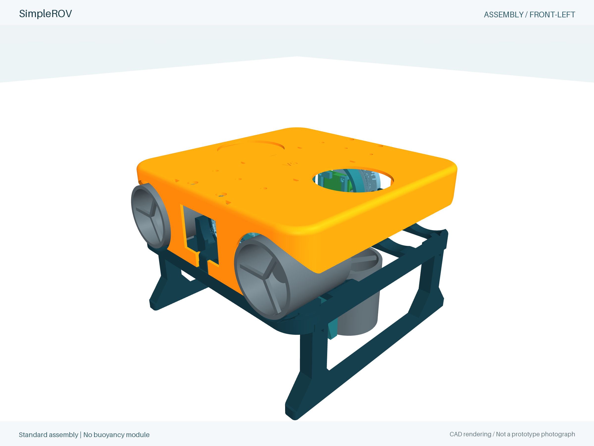
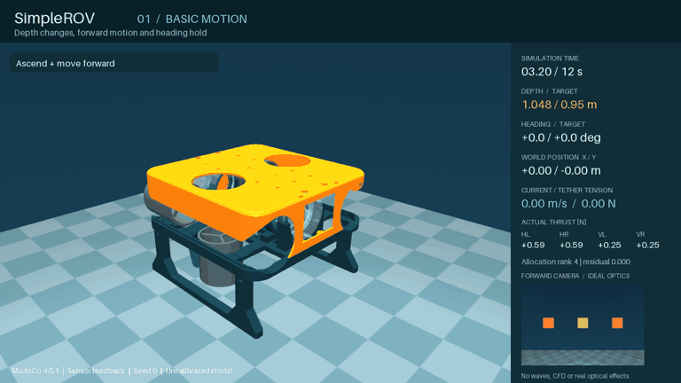
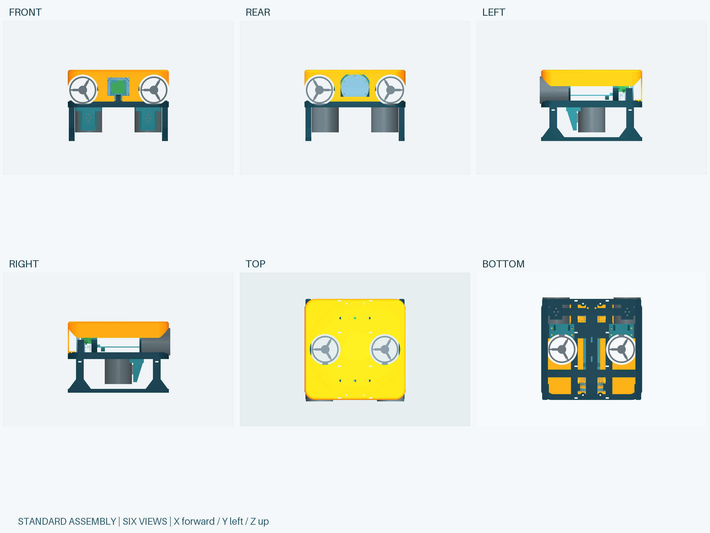
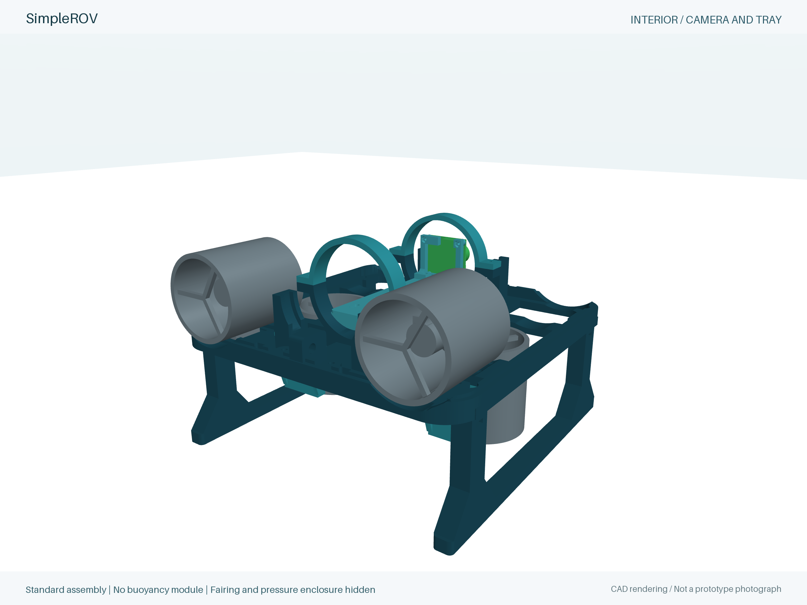
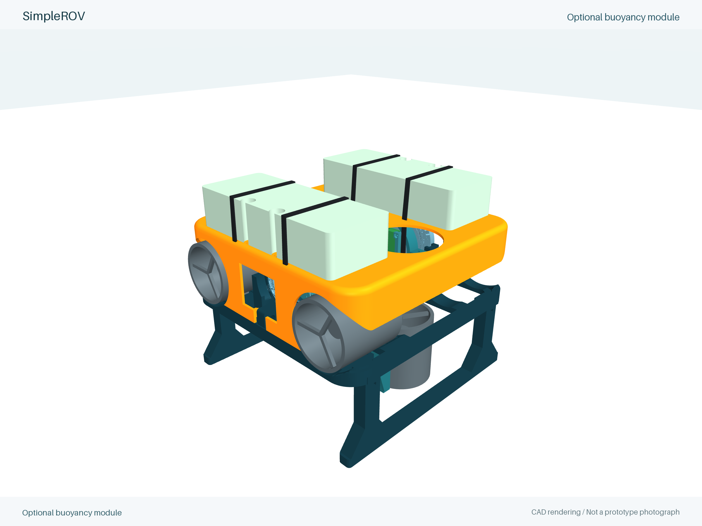
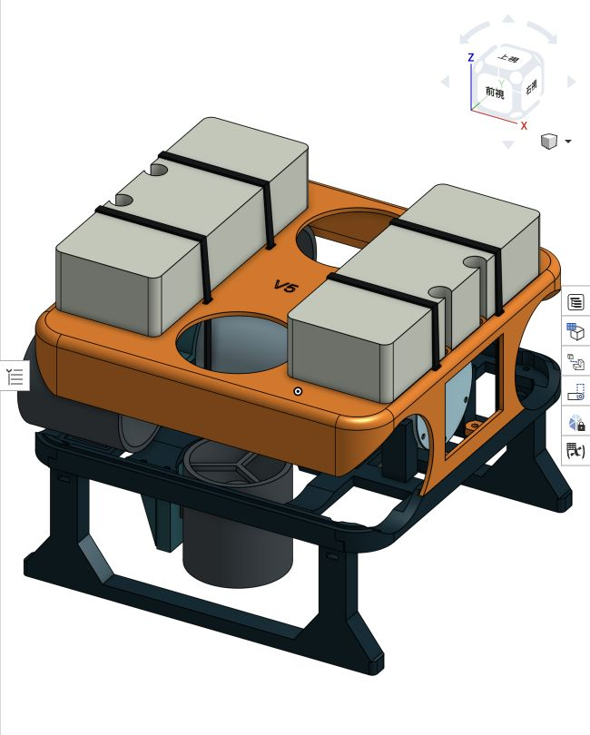
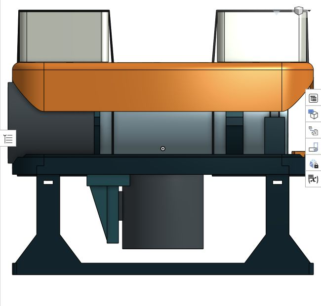
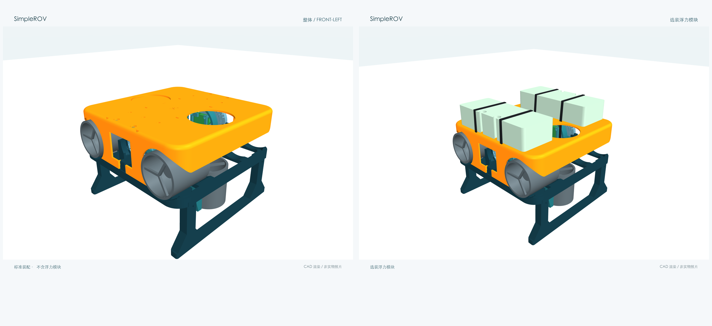

<div align="center">

# SimpleROV

**Un robot submarino compacto con cuatro propulsores.**

Mecánica imprimible · Montaje documentado · Simulación en MuJoCo

[English](README.md) · [**Español**](README.es.md) · [简体中文](README.zh-CN.md)

[](https://github.com/tianrking/simple-rov/actions/workflows/verify.yml)
[](https://github.com/tianrking/simple-rov/releases/tag/v0.0.1)
[](https://github.com/tianrking/simple-rov/blob/main/mechanical/README.md)



**213 × 210 × 148 mm** &nbsp; · &nbsp; **4 propulsores** &nbsp; · &nbsp; **10 piezas impresas**

[Montaje](docs/assembly.md) · [Descargas](https://github.com/tianrking/simple-rov/releases) · [Archivos CAD](mechanical/README.md) · [Simulación](docs/simulation.md) · [Galería](docs/gallery.md)

</div>

SimpleROV reúne el bastidor, los soportes de propulsión, la cámara, el alojamiento estanco y la simulación en un proyecto reproducible. Está pensado para empezar con pruebas de ajuste mecánico y avanzar hacia el control remoto por cable, el mantenimiento de profundidad y el control de rumbo.

El idioma principal del proyecto y de la documentación técnica es **inglés**. Este README ofrece una introducción en español; los manuales enlazados están en inglés.

El **montaje estándar no incluye espuma de flotabilidad superior ni correas**. Conserva las interfaces para añadir un módulo opcional tras medir la masa y el equilibrio del vehículo completo. Las imágenes son renderizados CAD, no fotografías de un prototipo probado.

## Vídeos de simulación

**Resumen de 48 segundos, reproducible aquí:** cuatro escenarios reales de MuJoCo, vídeo H.264 a 720p, telemetría y cámara frontal.

https://github.com/user-attachments/assets/2bf94293-84e5-456a-9249-f08cb007cc9f

| Escenario | Intervalo del resumen | Vídeo individual |
|---|---|---|
| Ascenso, descenso, avance y giro | 00:00-00:12 | [Piscina](docs/assets/videos/pool.mp4) |
| Corriente y deriva lateral | 00:12-00:24 | [Corriente](docs/assets/videos/cross-current.mp4) |
| Tensión y holgura del umbilical | 00:24-00:36 | [Cable](docs/assets/videos/tethered.mp4) |
| Fallo del propulsor H_LEFT | 00:36-00:48 | [Fallo de motor](docs/assets/videos/motor-fault.mp4) |

[Todos los reproductores y reproducción del experimento](docs/videos.md) · [Descargar MP4](docs/assets/videos/simple-rov-overview.mp4)

<details>
<summary><strong>Vista previa animada</strong></summary>

[](docs/assets/videos/simple-rov-overview.mp4)

</details>

Son trayectorias simuladas con parámetros sin calibrar, realimentación de sensores y semilla 0. Muestran control clásico con comandos programados, no pruebas físicas. Se conservan los MP4, trazas CSV, parámetros exactos y fuente de renderizado en el repositorio.

## Vista general

| Característica | Referencia actual |
|---|---|
| Dimensiones estándar, largo × ancho × alto | **213 × 210 × 148 mm** |
| Con el módulo de flotabilidad de referencia | 213 × 210 × 184,7 mm |
| Propulsión | 2 propulsores horizontales + 2 verticales, uno a cada lado |
| Movimientos | Avance, retroceso, ascenso, descenso y giro; el empuje vertical diferencial ayuda a corregir el balanceo |
| Piezas principales impresas | 10, más 2 probetas independientes para comprobar el montaje del motor |
| Propulsores de referencia | 4 × APISQUEEN X2 completos e impermeables |
| Alojamiento central de referencia | Blue Robotics, serie de 50 mm, tubo de 150 mm y diámetro exterior de 58 mm |
| Cámara de referencia | Blue Robotics Low-Light HD USB Camera |
| Fuentes editables | CadQuery, parámetros JSON, STEP y STL independientes |
| Simulación | MuJoCo, flotabilidad y resistencia aproximadas, control clásico |

Las dimensiones no incluyen los cables definitivos, pasacables estancos, terminación del umbilical, cierres de las correas ni lastre. El desplazamiento lateral y el cabeceo no tienen actuadores independientes. Las roscas reales del motor, las salidas de cable y el espacio para toda la electrónica aún deben comprobarse físicamente.

## Explorar la estructura



| Interior del bastidor | Módulo de flotabilidad opcional |
|:---:|:---:|
|  |  |

La vista interior oculta el carenado y los componentes del alojamiento de presión para mostrar la cámara, la bandeja y sus soportes. No demuestra que la batería, los cuatro variadores, el controlador y el equipo de vídeo definitivo quepan en el tubo.

### Capturas de Onshape

Son **capturas reales del montaje histórico en la nube**, con espuma y correas opcionales instaladas. El STEP estándar del repositorio define la configuración predeterminada sin espuma.

| Montaje en Onshape | Detalle de perfil |
|:---:|:---:|
|  |  |

[Abrir el montaje público de Onshape](https://cad.onshape.com/documents/256f9be06adfdc472f7aac06/w/aefb43ce726d3d5c24877f23/e/1186baa4f5bb2c01f6be971a) · [Galería y limitaciones de importación](docs/gallery.md#onshape-screenshots).

## Función de cada pieza

| Pieza | Cantidad | Función |
|---|---:|---|
| Chasis resistente | 1 | Une propulsores, patines, alojamiento y carenado; incorpora interfaces para umbilical, lastre y correas opcionales |
| Carenado superior | 1 | Protege la estructura y define el contorno; admite agua y no es un recipiente a presión |
| Patines | 2 | Apoyan el vehículo y protegen la parte inferior |
| Abrazaderas del alojamiento | 2 | Sujetan el tubo comercial con revestimientos blandos; no sellan las tapas |
| Soportes verticales | 2 | Fijan los propulsores verticales al chasis |
| Bandeja interior | 1 | Soporta la cámara y futuros adaptadores electrónicos; falta definir una retención axial positiva |
| Soporte de cámara | 1 | Sujeta la placa y deja espacio para el objetivo, USB y tornillería |
| Alojamiento estanco comercial | 1 conjunto | Mantiene seca la electrónica si se monta y se comprueba correctamente |
| Propulsores comerciales | 4 | Conjuntos completos de motor, hélice y conducto; no se imprimen |
| Espuma y correas | Opcionales | Añaden flotabilidad y permiten ajustar el equilibrio tras las mediciones |

## Elegir una configuración



| Configuración | Espuma / correas superiores | STEP |
|---|---|---|
| **Estándar** `base` | Ninguna | [simple-rov.step](mechanical/assemblies/simple-rov.step) |
| Opcional `with-buoyancy` | 2 piezas de espuma / 4 correas | [Montaje con flotabilidad](mechanical/assemblies/simple-rov-with-buoyancy.step) |

Ambas usan las mismas diez piezas impresas. También hay versiones con la tornillería metálica nominal en [mechanical/assemblies/](mechanical/assemblies/).

Las piezas de espuma de referencia miden 62 × 160 × 35 mm cada una y se cortan de un material de célula cerrada apropiado. **No se imprimen junto con el carenado.** La cantidad de compra predeterminada es cero; las cantidades opcionales se registran por separado.

Prescindir de la espuma no garantiza flotabilidad positiva ni ascenso pasivo al parar los motores. Hay que pesar el vehículo completo, medir su desplazamiento y comprobar el equilibrio totalmente sumergido. Véase [flotabilidad y equilibrio](docs/buoyancy.md).

## Construir el primer prototipo

1. **Comprobar un motor.** Comprar un propulsor y un variador bidireccional compatible. Ensayar las dos [probetas](mechanical/fit_coupons/) contra los agujeros, profundidad de rosca, apoyo y salida de cable reales.
2. **Comprobar la carga seca.** Distribuir a escala real batería, cuatro variadores, controlador, equipo de vídeo, conectores y cableado.
3. **Imprimir y montar.** Seguir el [listado de impresión](bom/PRINT_MANIFEST.csv), la [tornillería](bom/BOM_FASTENERS.csv) y la [guía ilustrada](docs/assembly.md). Montar los patines antes de que los propulsores horizontales bloqueen el acceso a sus tornillos.
4. **Completar fijación y cableado.** Añadir adaptadores aislados para cada placa, retención axial de la bandeja y pasacables adecuados al cable real.
5. **Comprobar estanqueidad y equilibrio.** Ensayar primero el alojamiento completo vacío y después una carga representativa de la masa final.
6. **Probar a poca profundidad.** En un entorno controlado y recuperable, verificar cada propulsor, órdenes remotas, mantenimiento de profundidad y parada por pérdida de comunicación.

La guía detalla dirección de los tornillos, arandelas, cantidades y puntos de inspección. [Montaje](docs/assembly.md) · [Aceptación](docs/acceptance.md) · [Plan del prototipo](docs/build-plan.md).

## Ejecutar MuJoCo

Desde la raíz del repositorio, con Python 3.12:

```bash
git clone https://github.com/tianrking/simple-rov.git
cd simple-rov
python3 -m venv .venv
source .venv/bin/activate
python -m pip install -r requirements/sim.txt
python simulation/mujoco/run.py --viewer --manual --seconds 300
```

En Windows: `.venv\Scripts\activate`. En macOS también se puede abrir `launch-macos.command` tras instalar las dependencias.

| Acción | Tecla |
|---|---|
| Avance / retroceso | Mantener W / S; soltar cancela el empuje longitudinal |
| Giro a izquierda / derecha | A / D; cambia el rumbo objetivo 15° |
| Ascenso / descenso | U / J; cambia la profundidad objetivo 0,1 m |
| Mantener profundidad y rumbo actuales | X; no bloquea la posición horizontal |
| Girar la vista / ampliar | Arrastrar con botón izquierdo / rueda |
| Salir | Esc o cerrar la ventana |

La ventana de conducción usa sus propios atajos. Al perder el foco cancela el empuje longitudinal, aunque el vehículo puede seguir moviéndose por inercia.

```bash
# Mostrar el módulo opcional
python simulation/mujoco/run.py --viewer --manual --configuration with-buoyancy --seconds 300

# Grabar demostración, CSV y vistas de cámara
python simulation/mujoco/run.py --render --output-dir runs/demo
```

### Física y control

El modelo incluye geometría CAD, dinámica de cuerpo rígido, cuatro puntos de empuje, flotabilidad y resistencia explícitas, retardo de motor y control clásico de profundidad, balanceo y rumbo. **Masa, inercia, centros de gravedad y flotabilidad, volumen desplazado, resistencia y empuje inverso son parámetros de ejemplo sin calibrar.** Cambiar de montaje modifica la geometría visible y las aproximaciones de colisión; no recalcula esos parámetros automáticamente.

El entorno supone inmersión completa y agua quieta. Incluye corrientes configurables y una aproximación del umbilical con tensión; no incluye oleaje, transición de superficie, dinámica distribuida del cable, CFD ni óptica submarina realista. Cargar solo el XML omite las fuerzas implementadas en Python: se debe usar `run.py`.

```python
from simulation.mujoco.environment import ROV

rov = ROV(configuration="base")
for _ in range(1000):
    forces = rov.controller(depth=1.2, surge_N=2.0, yaw=0.0)
    position, attitude, velocity, angular_velocity = rov.step(forces)
```

Los comandos son fuerzas en newtons: horizontal izquierdo, horizontal derecho, vertical izquierdo y vertical derecho. No son PWM ni RPM. El teclado fija el empuje longitudinal, la profundidad y el rumbo; el control clásico estabiliza profundidad, balanceo y rumbo en MuJoCo 4.0.1. [Conducción y control](docs/simulation.md).

La secuencia del proyecto es **ajuste y montaje mecánico → operación remota por cable → estabilización clásica → calibración medida y pruebas en agua poco profunda**. La selección de hardware y el código de a bordo siguen al prototipo mecánico.

## Hardware y conexiones

El [paquete de hardware](docs/hardware.md) documenta la controladora RP2040 de **80 × 32 mm**, cuatro ESC independientes, el ordenador de vídeo Pi Zero 2 W y el enlace Ethernet. Incluye [BOM del sistema](electronics/bom/SYSTEM_BOM.csv), [cableado](electronics/bom/HARNESS_BOM.csv), [consumibles y herramientas](electronics/bom/CONSUMABLES_TOOLS.csv) e [instrucciones de conexión](electronics/wiring.md).

La puesta en marcha inicial usa **12 V con límite total de 5 A**. El montaje completo de batería, ESC, vídeo, conectores y sellos sigue sin validar; el firmware de a bordo está pendiente. Consultar los bloqueos de compra antes de hacer un pedido.

## Editar y reproducir

| Recurso | Ubicación |
|---|---|
| Diez STL orientados para impresión | [mechanical/stl/](mechanical/stl/) |
| Diez piezas STEP editables | [mechanical/step_parts/](mechanical/step_parts/) |
| Parámetros y fuente CAD | [parameters.json](mechanical/parameters.json) · [build.py](mechanical/build.py) |
| Inventario de configuraciones | [configurations.json](mechanical/configurations.json) |
| BOM e interfaces | [bom/](bom/) |
| Manual ilustrado / PDF | [Guía](docs/assembly.md) · [PDF](docs/assembly.pdf) |
| Reconstrucción, verificaciones y publicación | [Desarrollo](docs/development.md) |

Al cambiar motores hay que revisar envolvente, plano de montaje, agujeros, profundidad, salida de cable, pasos de flujo y longitud de tornillo. Mantener sincronizados CAD, BOM, documentación y simulación. Los identificadores existentes de las piezas se conservan por compatibilidad.

## Estado del proyecto

Ya se ofrecen fuentes paramétricas, piezas independientes, dos configuraciones, guía de montaje, BOM mecánica, coordenadas de agujeros y simulación con control clásico.

Faltan la comprobación física de las interfaces del motor y las cargas de impresión, distribución electrónica completa, retención de bandeja, pasacables, gestión térmica, calibración de masa y empuje, estanqueidad y pruebas en agua. El diseño de la controladora está en revisión; el firmware y la validación del conjunto eléctrico siguen pendientes. Las verificaciones digitales no certifican fiabilidad ni profundidad de operación.

[Estado detallado](STATUS.json) · [Hoja de ruta](docs/roadmap.md) · [Cambios](CHANGELOG.md).

## Derechos y fuentes

El repositorio es público para revisión. **Todos los derechos del contenido original están reservados; no se concede una licencia de código abierto.** El CAD de terceros, los planos de fabricantes y las dependencias conservan los derechos de sus propietarios. [Licencia](LICENSE) · [Avisos de terceros](THIRD_PARTY_NOTICES.md) · [Fuentes](SOURCES.json).
