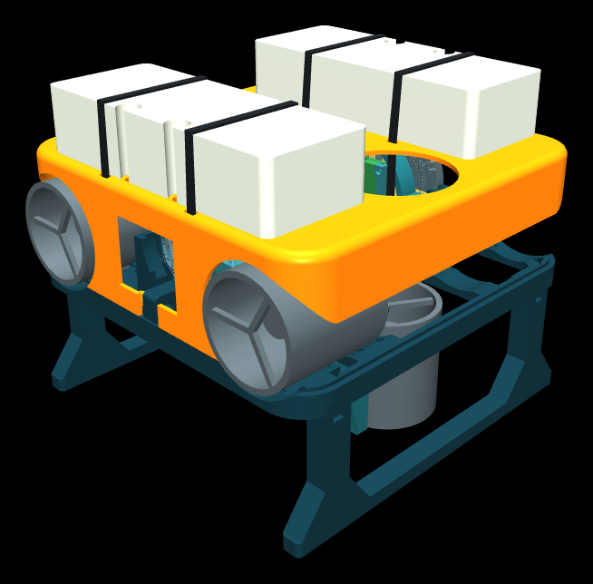

# SimpleROV

**小型四推进器水下机器人 · V5-01 结构工程与 MuJoCo 仿真**

A compact, four-thruster underwater robot engineering prototype: original mechanical structure, assembly documentation, BOM, and an editable MuJoCo simulator.



当前名义尺寸约 **213 × 210 × 185 mm**。两台水平直装推进器负责前后与转向，左右两台竖直推进器负责升降和横滚纠偏。原型面向淡水浅池、有线遥控和经典控制开发。

> **工程试装版，尚未实物验证。** 数字装配与软件功能检查不能证明结构强度、水密、额定潜深或实机性能。电机孔深、MCU适配板、托板锁止、穿舱线束、完整电气空间和散热仍需完成。仿真质量、水动力和推力反向上限未标定。

## 快速入口

| 想做什么 | 入口 |
|---|---|
| 看每个零件的作用与装配步骤 | [11页图文组装说明](docs/assembly.md) · [PDF](docs/assembly.pdf) · [网页](docs/assembly.html) |
| 打印10个主体件、2个试片 | [独立STL](mechanical/stl/) · [接口试片](mechanical/fit_coupons/) · [打印清单](bom/PRINT_MANIFEST.csv) |
| 编辑结构 | [独立STEP](mechanical/step_parts/) · [参数](mechanical/parameters.json) · [CadQuery源](mechanical/build.py) |
| 找总装或在线CAD | [结构总装](mechanical/MANTA_V5_CORE.step) · [含名义紧固件总装](mechanical/MANTA_V5_WITH_FASTENERS.step) · [Onshape](https://cad.onshape.com/documents/256f9be06adfdc472f7aac06/w/aefb43ce726d3d5c24877f23/e/1186baa4f5bb2c01f6be971a) |
| 买零件 | [BOM说明](bom/README.md) · [紧固件](bom/BOM_FASTENERS.csv) · [商用件](bom/BOM_PURCHASED.csv) |
| 运行仿真 | [仿真说明](docs/simulation.md) · [演示录像](simulation/mujoco/V5_sim_demo.mp4) |
| 做第一台实机 | [落地路线](docs/build-plan.md) · [验收条件](docs/acceptance.md) · [接口确认表](bom/component-confirmation.csv) |
| 后续PCB与固件 | [电子硬件规划](electronics/README.md) · [固件规划](firmware/README.md) |

## 目录

```text
mechanical/          参数化CAD、独立STEP/STL、总装、原厂参考与几何报告
simulation/mujoco/   水下受力环境、经典控制、独立驾驶窗口、验证与模型网格
bom/                 打印、紧固件、商用件与实物接口确认清单
electronics/         后续KiCad项目与机械接口约束；当前没有PCB设计
firmware/            实机控制与失效处理的后续规划；当前没有可烧录固件
docs/                装配、设计、验收、仿真、开发文档和图示
references/          厂家尺寸参考；权利和来源另行注明
tools/               文档生成、完整性检查与发布打包
validation/          发布检查与文档检查记录
requirements/        按用途固定的Python依赖
runs/                本机仿真日志/录像/测试临时输出，默认不提交
```

## 运行仿真

建议 Python 3.12。先在仓库根目录安装仿真依赖：

```bash
python3 -m venv .venv
source .venv/bin/activate
python -m pip install -r requirements/sim.txt
python simulation/mujoco/verify.py
python simulation/mujoco/verify_manual.py
python simulation/mujoco/run.py --viewer --manual --seconds 300
```

Windows激活命令为 `.venv\Scripts\activate`。Mac也可在安装依赖后双击 `launch-macos.command`。

**独立驾驶窗口不使用MuJoCo自带查看器的字母热键。** 按住 **W/S** 前后推进，松开或窗口失焦后取消前后推力；**A/D** 调整航向15°，**U/J** 调整深度0.1m，**X** 保持当前深度和航向，**Esc** 退出。鼠标左键拖动旋转视角，滚轮缩放。取消推力不等于立即刹停或锁住水平位置。

离线自动演示与录像：

```bash
python simulation/mujoco/run.py --render --output-dir runs/demo
```

结果写入独立的 `runs/` 子目录。浮力、水阻和电机滞后由Python计算，必须通过 `run.py` 运行；只打开XML缺少这些水下外力。当前未包含Gymnasium训练接口、训练策略、海流、海浪、系缆力或自由液面穿越。

## 复建与检查

```bash
python -m pip install -r requirements/cad.txt
python mechanical/build.py
python mechanical/build_fit_coupons.py
python mechanical/verify.py
python mechanical/export_metadata.py
python simulation/mujoco/build_model.py
python simulation/mujoco/verify.py
python simulation/mujoco/verify_manual.py
python tools/validate_repository.py
```

修改CAD后应同步更新孔位、BOM、仿真和文档。[开发与复建说明](docs/development.md)解释检查范围和可复现输出；[项目状态](STATUS.json)、[变更记录](CHANGELOG.md)和[路线图](docs/roadmap.md)标明当前与未来工作。

## 控制与可靠性边界

当前示例控制器为比例/微分反馈与浮力前馈，可用于定深、定向和横滚研究；前后输入为合力。四输入布局无法独立横移或主动控制俯仰，也不提供绝对水平位置悬停。实机先做接口试装、密封与配平，再用经典控制调试；强化学习属于后续研究。

## 权利与署名

**公开仓库，原创内容保留全部权利；暂未授予开源许可。** 详见 [LICENSE](LICENSE)。第三方CAD、厂家图纸及依赖保留原作者权利，见 [THIRD_PARTY_NOTICES.md](THIRD_PARTY_NOTICES.md) 与 [SOURCES.json](SOURCES.json)。
