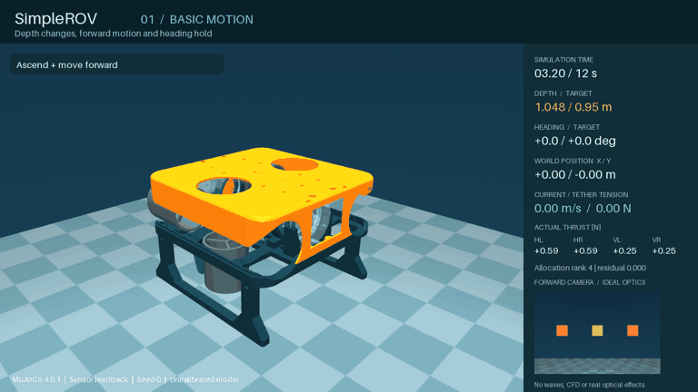
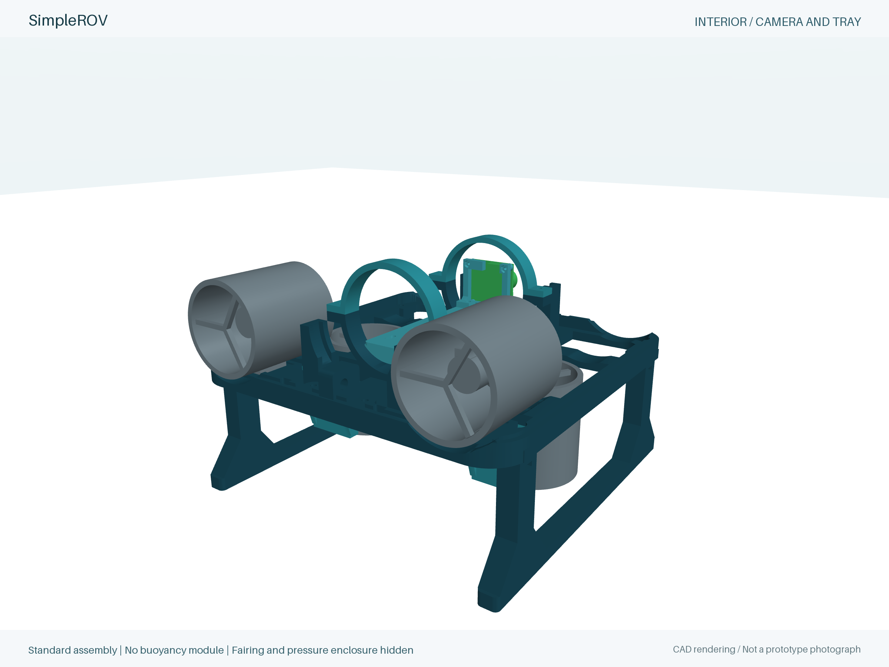
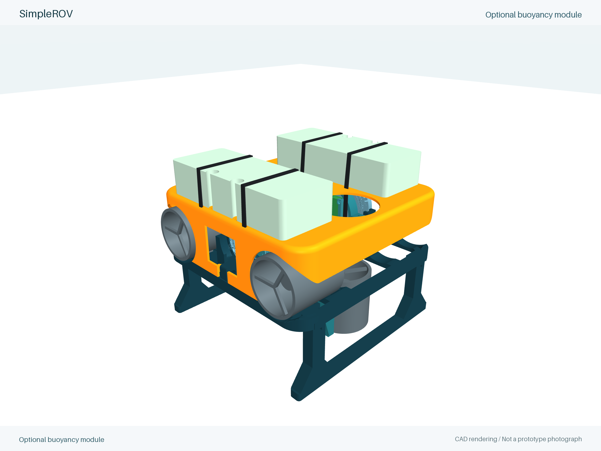
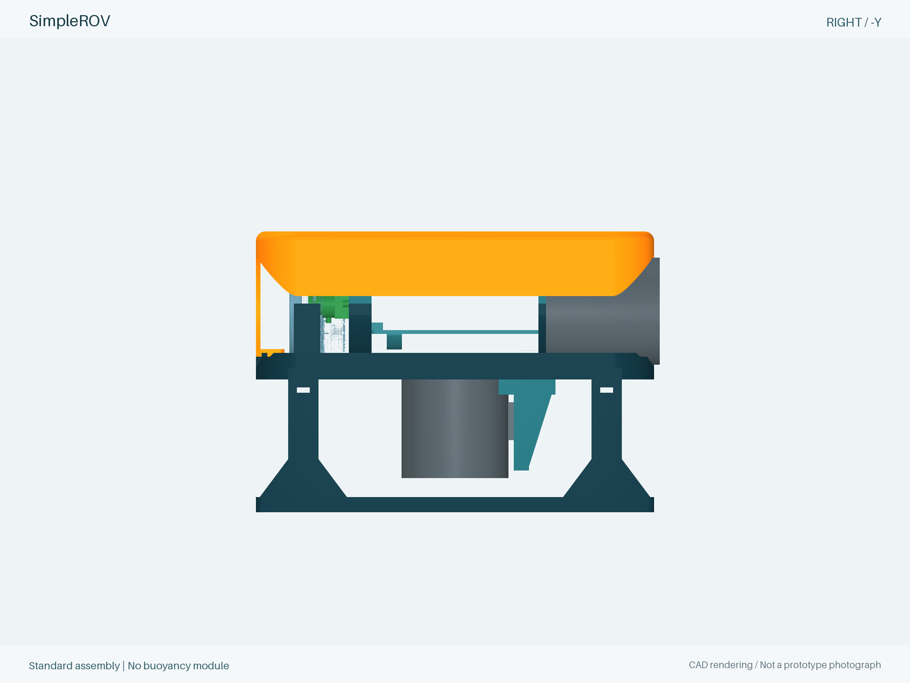
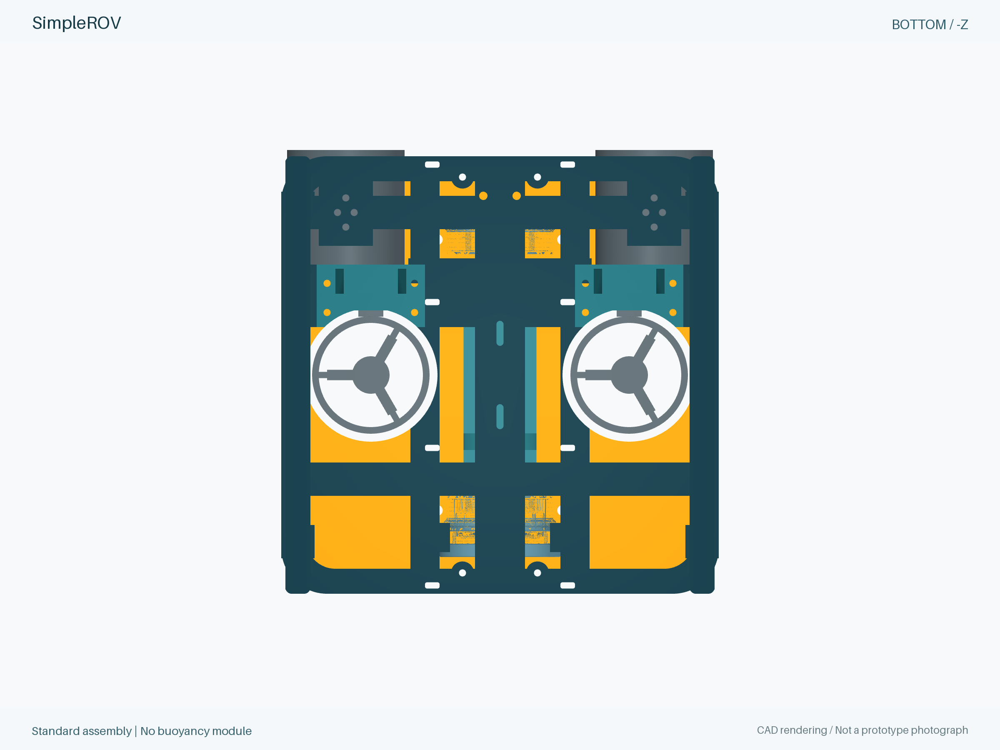
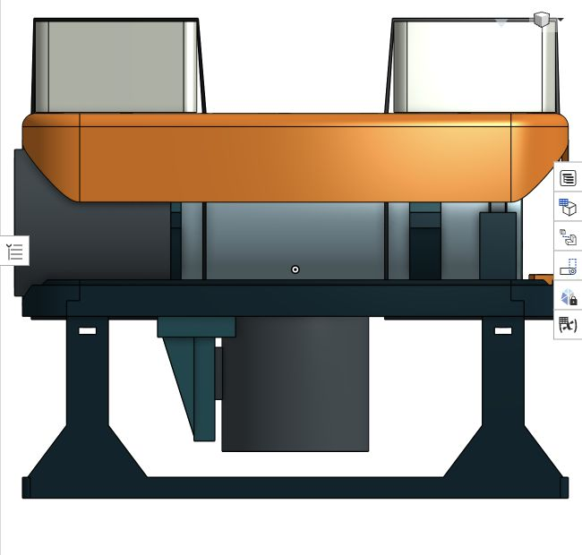
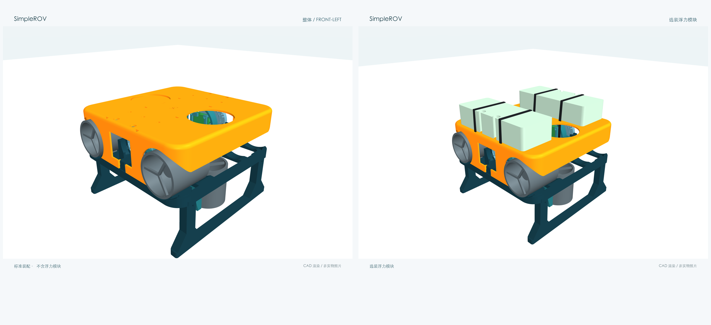
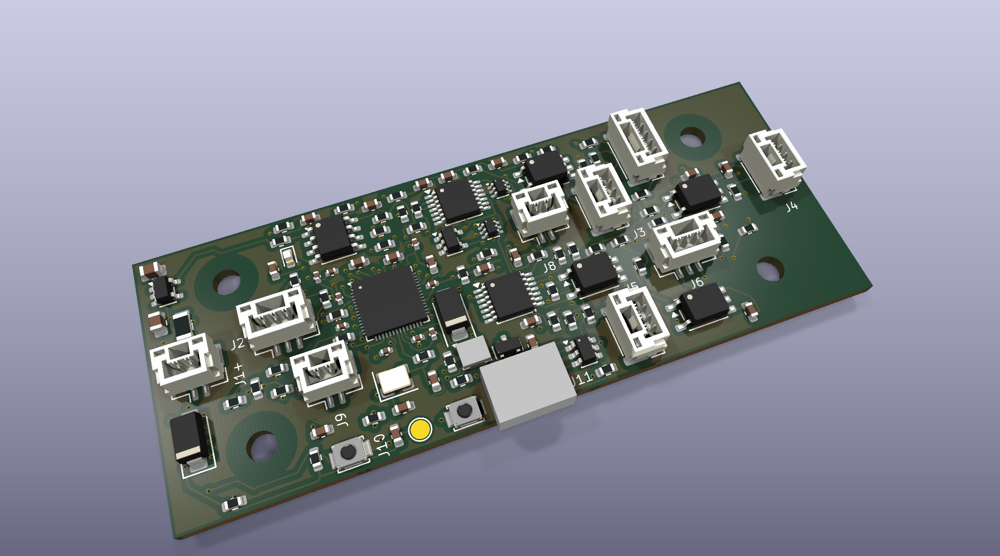

<div align="center">

# SimpleROV

**A compact four-thruster underwater robot.**

Printable mechanics · Documented assembly · MuJoCo simulation

[**English**](README.md) · [Español](README.es.md) · [简体中文](README.zh-CN.md)

[](https://github.com/tianrking/simple-rov/actions/workflows/verify.yml)
[](https://github.com/tianrking/simple-rov/releases/tag/v0.0.1)
[](https://github.com/tianrking/simple-rov/blob/main/mechanical/README.md)
[](https://github.com/tianrking/simple-rov/blob/main/docs/simulation.md)


**213 × 210 × 148 mm** &nbsp; · &nbsp; **4 thrusters** &nbsp; · &nbsp; **10 printed parts**

[Assembly guide](docs/assembly.md) · [Download](https://github.com/tianrking/simple-rov/releases) · [CAD files](mechanical/README.md) · [Simulation](docs/simulation.md) · [Gallery](docs/gallery.md)

</div>

SimpleROV brings the frame, thruster mounts, camera carrier, enclosure mounts and simulation into one reproducible project. Start with a mechanical fit check, then develop tethered remote control, depth hold and heading hold around the same coordinate system.

The **standard assembly has no top buoyancy foam or retention straps**. Mounting routes remain available for an optional buoyancy module, selected after measuring the completed vehicle's mass and trim. These images are CAD renderings, not photographs of tested hardware.

## Simulation videos

**Watch the 48-second overview directly below:** four actual MuJoCo scenarios, 720p H.264, live telemetry and the forward camera.

https://github.com/user-attachments/assets/2bf94293-84e5-456a-9249-f08cb007cc9f

| Chapter | Overview time | What to watch | Individual video |
|---|---|---|---|
| Basic motion | 00:00-00:12 | Rise, descend, move forward and turn | [Pool](docs/assets/videos/pool.mp4) |
| Water current | 00:12-00:24 | Current arrow, changing position and lateral drift | [Cross-current](docs/assets/videos/cross-current.mp4) |
| Tether load | 00:24-00:36 | Tension/slack state and line force at the chassis eye | [Tether](docs/assets/videos/tethered.mp4) |
| Motor failure | 00:36-00:48 | H_LEFT at zero thrust, rank loss and allocation residual | [Motor fault](docs/assets/videos/motor-fault.mp4) |

[All video players and reproduction details](docs/videos.md) · [Download the overview MP4](docs/assets/videos/simple-rov-overview.mp4)

<details>
<summary><strong>Animated preview for mirrors without native video playback</strong></summary>

[](docs/assets/videos/simple-rov-overview.mp4)

</details>

These are simulated trajectories with uncalibrated parameters, sensor feedback and seed 0. They are classical-control demonstrations, not physical robot footage. MP4 originals, per-frame state traces and exact run metadata are committed alongside the rendering source.

## At a glance

| Mechanics | Propulsion | Development |
|---|---|---|
| Compact load-bearing frame | Two horizontal + two vertical thrusters | Editable CadQuery source and STEP |
| Commercial central dry enclosure | Forward/reverse, ascent/descent, yaw | Independent, bed-oriented STL files |
| Removable fairing and skids | Differential vertical thrust assists roll | MuJoCo environment and classical control |
| Optional top buoyancy module | Four independent force commands | Illustrated assembly, BOM and checks |

| Specification | Current reference |
|---|---|
| Standard envelope, L × W × H | **213 × 210 × 148 mm** |
| With the reference buoyancy module | 213 × 210 × 184.7 mm |
| Main printed parts | 10, plus 2 separate motor-fit coupons |
| Thruster reference | 4 × APISQUEEN X2 complete waterproof thrusters |
| Central enclosure reference | Blue Robotics 50 mm series, 150 mm tube, 58 mm outside diameter |
| Camera reference | Blue Robotics Low-Light HD USB Camera |
| Coordinates | X forward, Y left, Z up; CAD in mm, simulation in m |

Dimensions exclude the final cables, penetrators, tether termination, strap buckles and ballast. Sway and pitch have no independent actuators. Actual motor threads, cable exits and the complete electrical packaging still need physical confirmation.

## Explore the structure


| Inside the frame | Optional buoyancy module |
|:---:|:---:|
|  |  |

The interior view removes the fairing and pressure enclosure components to show the camera carrier, tray and mounts. It does not imply that the final battery, controller, four ESCs and video host have been packaged.

<details>
<summary><strong>Open the six individual views</strong></summary>

| Front | Rear |
|:---:|:---:|
|  |  |

| Left | Right |
|:---:|:---:|
|  |  |

| Top | Bottom |
|:---:|:---:|
|  |  |

</details>

### In Onshape

These are **actual screenshots of the historical cloud assembly**, shown with the optional foam and straps fitted. The repository's standard STEP remains the reference for the default, foam-free configuration.

| Assembly workspace | Profile detail |
|:---:|:---:|
|  |  |

[Open the public Onshape assembly](https://cad.onshape.com/documents/256f9be06adfdc472f7aac06/w/aefb43ce726d3d5c24877f23/e/1186baa4f5bb2c01f6be971a) · [View provenance and import limitations](docs/gallery.md#onshape-screenshots)

## What each part does

| Part | Qty. | Purpose |
|---|---:|---|
| Load chassis | 1 | Carries thrust loads and joins the skids, enclosure, mounts and fairing; provides tether and ballast interfaces |
| Upper fairing | 1 | Protects the structure and defines its outline; freely floods and is not a pressure vessel |
| Skids | 2 | Support the vehicle on a bench or pool floor and protect its underside |
| Enclosure clamps | 2 | Retain the commercial tube with soft liners; do not seal the endcaps |
| Vertical carriers | 2 | Mount the vertical thrusters and transfer their loads to the chassis |
| Internal tray | 1 | Supports the camera carrier and future electronics adapters; positive axial retention remains to be designed |
| Camera carrier | 1 | Positions the camera board and provides lens, USB and fastener clearance |
| Commercial pressure enclosure | 1 set | Keeps ordinary electronics dry when correctly assembled and leak-tested |
| Commercial thrusters | 4 | Complete motor, propeller and duct assemblies; not printed by this project |
| Buoyancy foam and straps | Optional | Add buoyancy and adjust trim after measurement |

## Choose an assembly



| Configuration | Top foam / straps | Assembly STEP | With nominal metal fasteners |
|---|---|---|---|
| **Standard** `base` | None | [simple-rov.step](mechanical/assemblies/simple-rov.step) | [Fastener assembly](mechanical/assemblies/simple-rov-with-fasteners.step) |
| Optional `with-buoyancy` | 2 foam pieces / 4 straps | [Buoyancy assembly](mechanical/assemblies/simple-rov-with-buoyancy.step) | [Buoyancy + fasteners](mechanical/assemblies/simple-rov-buoyancy-with-fasteners.step) |

Both configurations share the same ten printed parts. Foam is cut from suitable closed-cell material; it is **not printed as part of the fairing**. Its default purchase quantity is zero, with optional quantities recorded separately.

Omitting foam does not establish positive buoyancy or guarantee a passive ascent. Weigh the complete vehicle, measure displacement and check fully submerged trim before deciding whether to add foam or ballast. See [buoyancy and trim](docs/buoyancy.md).

## Build a first prototype

1. **Check one motor first.** Buy one reference thruster and a matching bidirectional ESC. Test both [fit coupons](mechanical/fit_coupons/) against the actual mounting face, holes, blind depth and cable exit.
2. **Check the dry payload.** Lay out the real battery, four ESCs, controller, video host, connectors and wiring at full scale before assuming they fit the tube.
3. **Print and assemble.** Use the [print manifest](bom/PRINT_MANIFEST.csv), [fastener BOM](bom/BOM_FASTENERS.csv) and [illustrated guide](docs/assembly.md). Install skids before horizontal thrusters obstruct their tool paths.
4. **Complete retention and wiring.** Add board-specific insulated adapters and positive tray retention. Select penetrators for the actual cable construction.
5. **Leak-test and trim.** Test the complete empty enclosure, then use representative payload mass to establish buoyancy and balance.
6. **Run controlled shallow-water checks.** Verify individual thrust directions, remote commands, depth/heading hold and loss-of-command shutdown in a recoverable setting.

The guide specifies screw directions, washers, quantities and inspection hold points. Start with [assembly](docs/assembly.md), [acceptance](docs/acceptance.md) and the [prototype build plan](docs/build-plan.md).

## Run the simulation

From the repository root, using Python 3.12:

```bash
git clone https://github.com/tianrking/simple-rov.git
cd simple-rov
python3 -m venv .venv
source .venv/bin/activate
python -m pip install -r requirements/sim.txt
python simulation/mujoco/run.py --viewer --manual --seconds 300
```

On Windows, activate with `.venv\Scripts\activate`. On macOS, after installing dependencies, you can also open `launch-macos.command`.

| Control | Input |
|---|---|
| Forward / reverse | Hold W / S; release to cancel surge thrust |
| Turn left / right | A / D; change heading target by 15° |
| Ascend / descend | U / J; change depth target by 0.1 m |
| Hold current depth and heading | X; does not lock horizontal position |
| Orbit / zoom | Left mouse drag / scroll wheel |
| Quit | Esc or close the window |

The dedicated driving window isolates these keys from MuJoCo's built-in viewer shortcuts. Losing focus cancels surge thrust; the vehicle can still coast.

```bash
# Display the optional assembly
python simulation/mujoco/run.py --viewer --manual --configuration with-buoyancy --seconds 300

# Record an automatic demonstration, state CSV and camera views
python simulation/mujoco/run.py --render --output-dir runs/demo
```

### Physics and control

Powered by **MuJoCo 4.0.1**, the foundation includes relative-current drag, buoyancy, delayed/rate-limited actuators, bounded allocation, sensor proxies, classical control, a lumped tether and fault scenarios. [Simulation foundation](docs/simulation-foundation.md). **Mass, inertia, centers of gravity/buoyancy, displacement, drag and reverse thrust are uncalibrated example parameters.** Changing the assembly changes visuals and associated collision proxies; it does not automatically recalculate those parameters.

This is a fully submerged, still-water model. It includes configurable current and a tension-only tether approximation; it does not include waves, free-surface transitions, distributed cable dynamics, CFD or realistic underwater optics. Open it through `run.py`: loading an XML alone omits the Python underwater forces.

```python
from simulation.mujoco.environment import ROV

rov = ROV(configuration="base")
for _ in range(1000):
    forces = rov.controller(depth=1.2, surge_N=2.0, yaw=0.0)
    position, attitude, velocity, angular_velocity = rov.step(forces)
```

Commands are forces in newtons, ordered horizontal-left, horizontal-right, vertical-left, vertical-right. They are not PWM or RPM. Keyboard commands set surge thrust, target depth and target heading; classical feedback stabilizes depth, roll and heading. [Driving and control documentation](docs/simulation.md).

To try a water current while driving:

```bash
python simulation/mujoco/run.py --scenario cross-current --viewer --manual --seconds 300
```

The development path is **mechanical fit and assembly → tethered remote operation → classical stabilization → measured calibration and shallow-water trials**. Hardware selection and onboard code follow the mechanical prototype.

## Hardware and connections

The hardware work follows the current small frame and tray. A dedicated **80 × 32 mm RP2040 controller board** handles sensing and four ESC signal channels; propulsion current stays in a separate protected harness. A **Pi Zero 2 W with an Ethernet/USB hub** handles the existing USB camera and tethered communication. Onboard code is still to be implemented.

[KiCad controller](electronics/pcb/controller/SimpleROV001_control.kicad_pro) · [Schematic](electronics/pcb/drawings/schematic.pdf) · [PCBA BOM](electronics/pcb/controller/BOM.csv) · [Hardware overview](docs/hardware.md) · [System BOM](electronics/bom/SYSTEM_BOM.csv) · [Harness BOM](electronics/bom/HARNESS_BOM.csv) · [Consumables and tools](electronics/bom/CONSUMABLES_TOOLS.csv) · [Wiring](electronics/wiring.md)



The first electrical commissioning configuration is **12 V with a 5 A total source limit**, not the full propulsion rating. The native controller STEP, GH plug reservations and mounting hardware have been checked against the unchanged core geometry; the battery, four ESCs, host/hub, plugs, heat rejection and complete cable seals are not a verified fitted package. Purchase holds are explicit in the BOM. [Power and battery boundary](electronics/power.md) · [Mechanical interface](electronics/interfaces/README.md).

## Edit and reproduce

| Need | Entry point |
|---|---|
| Ten bed-oriented prints | [mechanical/stl/](mechanical/stl/) |
| Ten editable STEP parts | [mechanical/step_parts/](mechanical/step_parts/) |
| Dimensions and CAD source | [parameters.json](mechanical/parameters.json) · [build.py](mechanical/build.py) |
| Configuration inventory | [configurations.json](mechanical/configurations.json) |
| Printed, purchased and metal parts | [bom/](bom/) |
| Installation instructions | [Assembly guide](docs/assembly.md) · [PDF](docs/assembly.pdf) |
| Change workflow and checks | [Development guide](docs/development.md) |

<details>
<summary><strong>CAD and simulation rebuild commands</strong></summary>

```bash
python -m pip install -r requirements/cad.txt
python mechanical/build.py
python mechanical/build_fit_coupons.py
python mechanical/verify.py
python mechanical/export_metadata.py
python mechanical/verify_configurations.py
python simulation/mujoco/build_model.py
python simulation/mujoco/verify.py
python simulation/mujoco/verify_manual.py
```

</details>

When changing motors, check the full envelope, mounting-face offset, hole pattern, depth, cable exit, propeller flow paths and screw length. Keep CAD, BOM, documents and simulation in sync. Existing part IDs are retained for compatibility with printed parts and hole tables.

```text
mechanical/          Parametric CAD, separate parts, assemblies and supplier references
simulation/mujoco/   Underwater forces, classical control, driving and checks
bom/                 Print, purchase, fastener and interface records
electronics/         Controller PCB engineering, system BOM, wiring and interfaces
firmware/            Future onboard implementation and failure handling
docs/                Assembly, design, trim, simulation, development and images
validation/          Digital check records and historical Onshape import records
requirements/        Dependencies grouped by purpose
runs/                Local outputs; excluded from version control
```

## Project status

| Available now | Still to validate or develop |
|---|---|
| Parametric mechanics, separate prints and two assembly variants | Actual motor mounting depth, cable exits and print load capacity |
| Illustrated guide, mechanical BOM and hole coordinates | Full electronics packaging, tray retention, penetrators and thermal management |
| MuJoCo demonstrator and classical control | Measured mass, trim, thrust and hydrodynamic calibration |
| Digital consistency and regression checks | Physical assembly, sealing and shallow-water trials |

The [hardware engineering package](docs/hardware.md) adds controller design, system selection, wiring and material lists. Read its board-review and procurement status before ordering. Complete electrical packaging and flashable onboard firmware remain pending. Digital checks are evidence about files, geometry and software, not a reliability or depth certification. [Status](STATUS.json) · [Roadmap](docs/roadmap.md) · [Changelog](CHANGELOG.md).

## Rights and sources

This repository is public for review. **All rights reserved for original content; no open-source license is granted.** Third-party CAD, manufacturer drawings and dependencies retain their owners' rights. [License](LICENSE) · [Third-party notices](THIRD_PARTY_NOTICES.md) · [Sources](SOURCES.json).
