# SimpleROV

[English](README.md) · [Español](README.es.md) · [**简体中文**](README.zh-CN.md)

项目默认技术文档为英文，本页为中文入口。

小型四推进器水下机器人，包含可打印的机械结构、装配说明、物料清单和 MuJoCo 仿真。适合从机械试装开始，逐步完成有线遥控、定深和定向控制。

[](https://github.com/tianrking/simple-rov/actions/workflows/verify.yml)

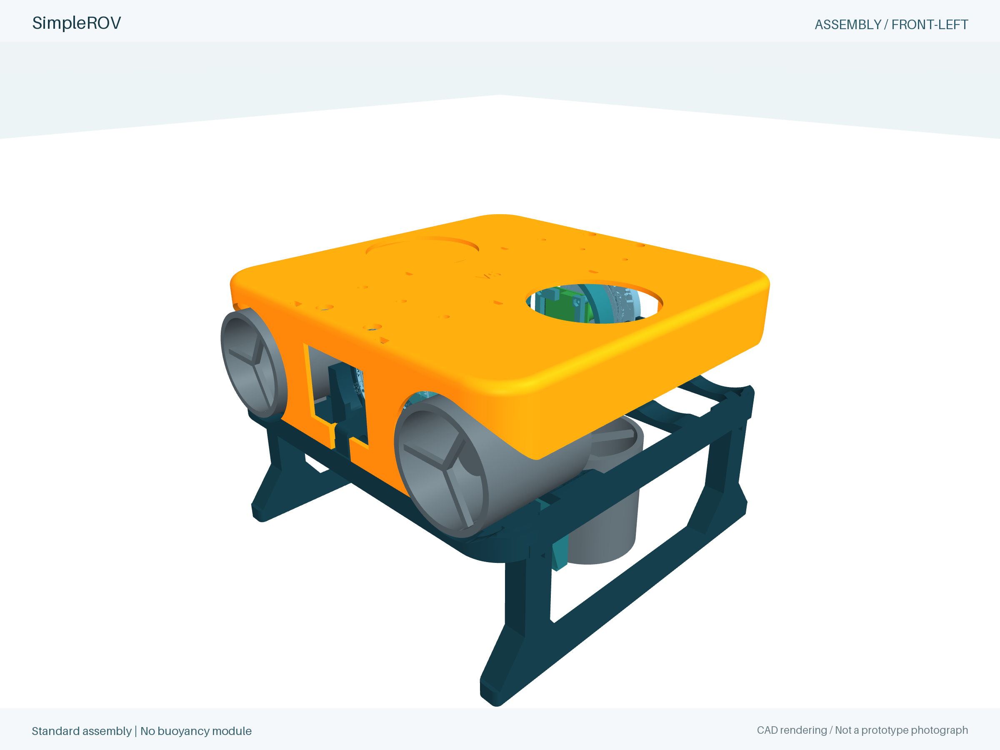

**标准装配不包含顶部浮力块或绑带，外包尺寸约 213 × 210 × 148 mm。** 机架保留浮力模块的安装位置，可根据实际重量和水中配平结果增加浮材。图像由本项目 CAD 生成，尚未选定的电子模块和线束没有画入；这些不是实物照片。

[装配说明](docs/assembly.md) · [打印文件](mechanical/stl/) · [物料清单](bom/README.md) · [运行仿真](docs/simulation.md) · [图像与视图](docs/gallery.md) · [版本下载](https://github.com/tianrking/simple-rov/releases)

## 仿真视频

**下方可直接播放 48 秒总览**，包含四个实际 MuJoCo 场景、720p H.264 画面、实时数据和前视相机。

https://github.com/user-attachments/assets/2bf94293-84e5-456a-9249-f08cb007cc9f

| 场景 | 总览时间 | 单独视频 |
|---|---|---|
| 上升、下降、前进、转向 | 00:00-00:12 | [基础运动](docs/assets/videos/pool.mp4) |
| 水流与横向漂移 | 00:12-00:24 | [水流场景](docs/assets/videos/cross-current.mp4) |
| 系缆张力与松弛 | 00:24-00:36 | [系缆场景](docs/assets/videos/tethered.mp4) |
| H_LEFT 推进器停机 | 00:36-00:48 | [电机故障](docs/assets/videos/motor-fault.mp4) |

[完整视频库与复现说明](docs/videos.md) · [下载总览 MP4](docs/assets/videos/simple-rov-overview.mp4)

<details>
<summary><strong>动图预览</strong></summary>

[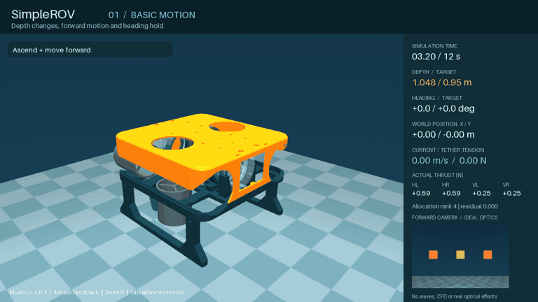](docs/assets/videos/simple-rov-overview.mp4)

</details>

视频来自未标定模型，采用传感器反馈和随机种子 0；不是实机测试或强化学习策略结果。原始 MP4、逐帧状态 CSV、运行参数和渲染源码均保存在仓库中。

## 项目概览

SimpleROV 采用两个水平推进器和两个竖直推进器。承力底架连接推进器、中央密封舱和滑橇，上罩负责外部保护；电子设备安装在密封舱内。默认配置保留完整的四推进器布局，不安装额外的浮力模块。

| 项目 | 内容 |
|---|---|
| 运动方式 | 前进、后退、上升、下降、偏航；竖推差动辅助保持横滚水平 |
| 推进器布局 | 水平直装 2 台，左右竖直安装 2 台 |
| 标准外包尺寸 | 约 213 × 210 × 148 mm，长 × 宽 × 高 |
| 加装现有浮力模块后 | 约 213 × 210 × 185 mm |
| 主体打印件 | 10 件，另有 2 个电机接口试片 |
| 中央舱参考 | 50 mm 系列、150 mm 管，外径 58 mm |
| 推进器参考 | APISQUEEN X2 成品防水推进器，实际孔深与出线待样件核对 |
| 相机参考 | Blue Robotics Low-Light HD USB Camera |
| 机械源文件 | CadQuery Python、参数文件、独立 STEP 与 STL |
| 仿真 | MuJoCo 刚体模型、四路推力、浮力和水阻近似、经典反馈控制 |

上述尺寸不包含后续选定的线缆、穿舱接头、系缆头及配重。系统没有独立横移和主动俯仰控制；“保持深度和航向”也不等于锁定水平位置。

## 多视角查看结构

以下六个方向采用一致的正投影视图，方便检查推进器方向、机架轮廓、滑橇和中央舱的位置。坐标约定为 **X 向前、Y 向左、Z 向上**。

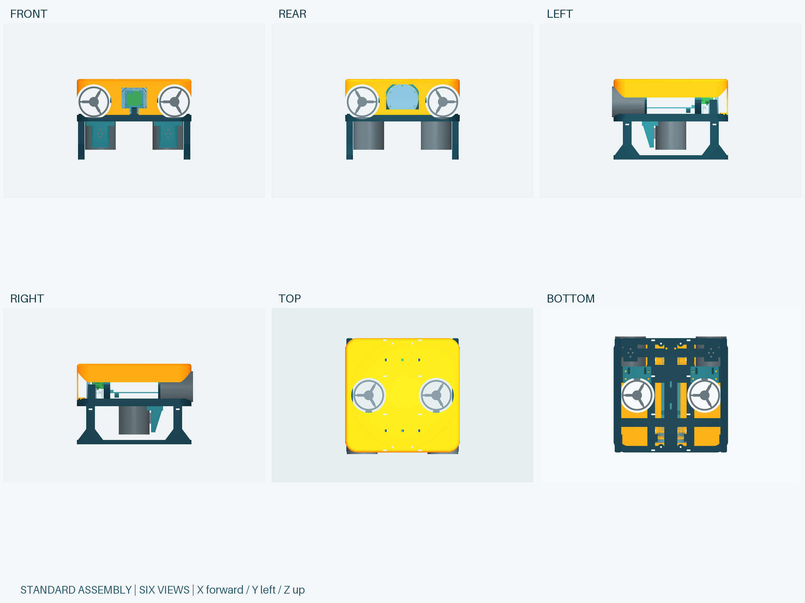

| 前视 | 后视 |
|---|---|
| 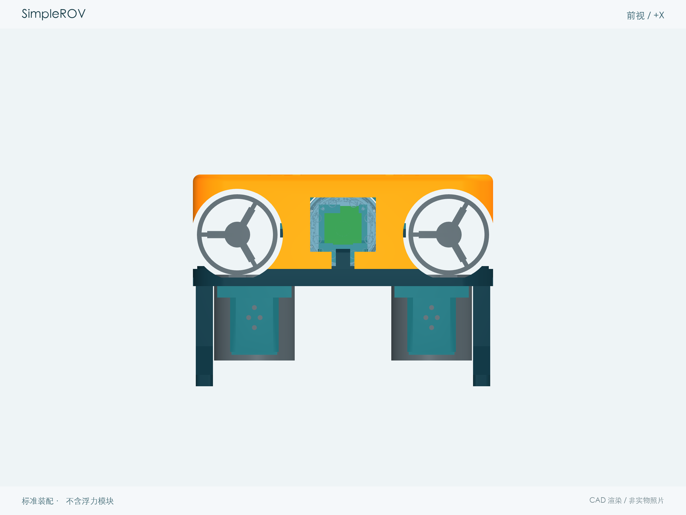 | 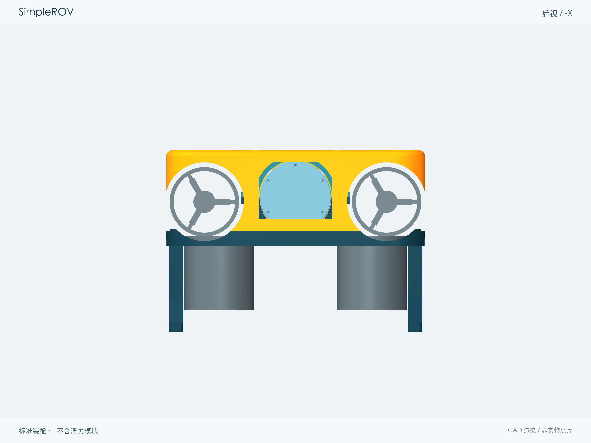 |

| 左视 | 右视 |
|---|---|
| 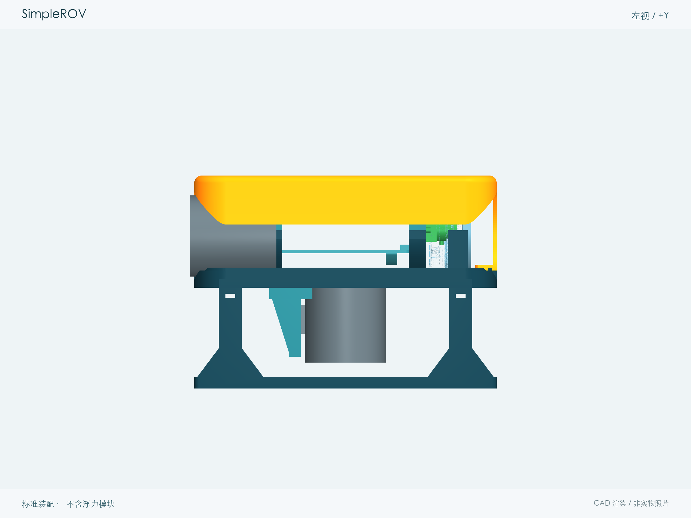 | 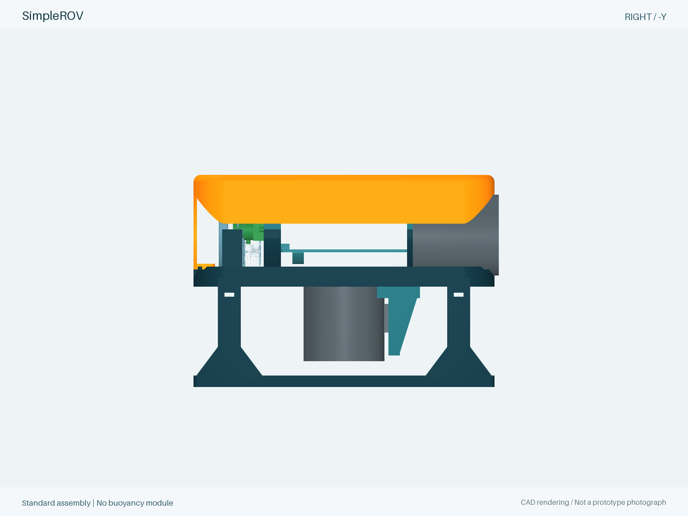 |

| 俯视 | 底视 |
|---|---|
| 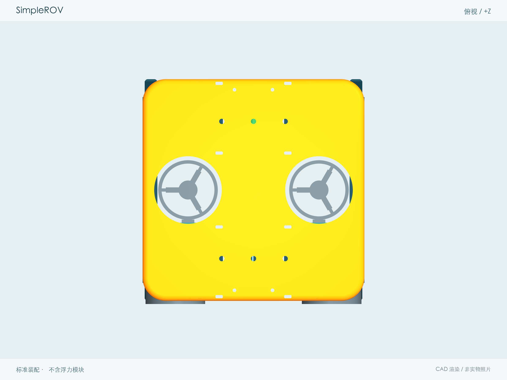 | 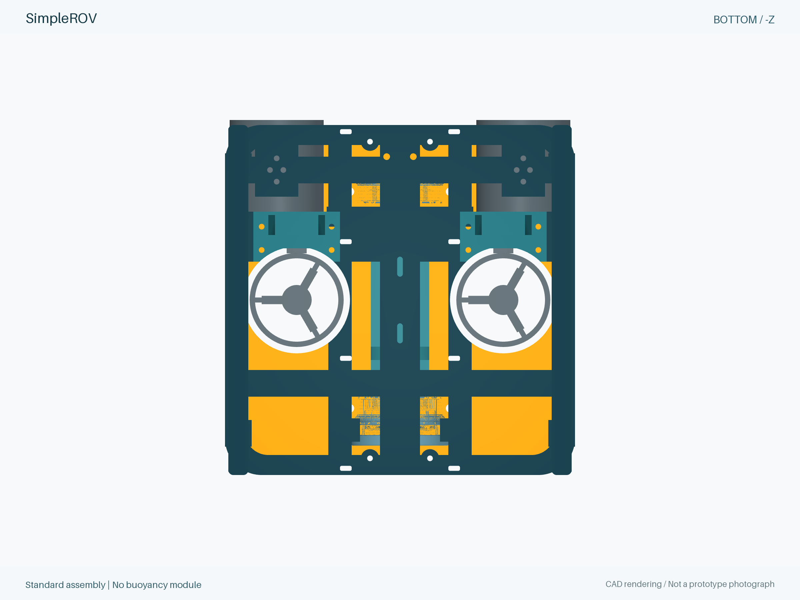 |

[查看内部安装、选装配置及原分辨率图片](docs/gallery.md)。

## 每个部分的用途

| 部分 | 数量 | 用途 |
|---|---:|---|
| 承力底架 | 1 | 连接推进器、舱座、滑橇和上罩，承受推进力；保留系缆、配重与选装绑带位置 |
| 上罩 | 1 | 保护内部结构并整理外形，留出推进器水路、相机观察口和螺钉工具通道；允许进水 |
| 左右滑橇 | 2 | 放置和落地支承，保护下方结构 |
| 舱压环 | 2 | 配合软衬固定中央密封舱，不承担端盖密封 |
| 竖推支架 | 2 | 固定左右竖直推进器，并把推力传到承力底架 |
| 内部托板 | 1 | 支持相机架和后续电子模块安装，最终板卡适配及机械锁止需要按实物补完 |
| 相机架 | 1 | 固定相机板，提供镜头和 USB 接口让位 |
| 密封舱组件 | 1 套 | 为控制器、电调等电子设备提供干燥空间，使用匹配的商用密封组件 |
| 推进器 | 4 | 购买带电机、桨和导流罩的完整防水推进器；不作为本项目打印件 |
| 浮力模块 | 选装 | 提供额外净浮力并辅助配平；标准配置不安装 |

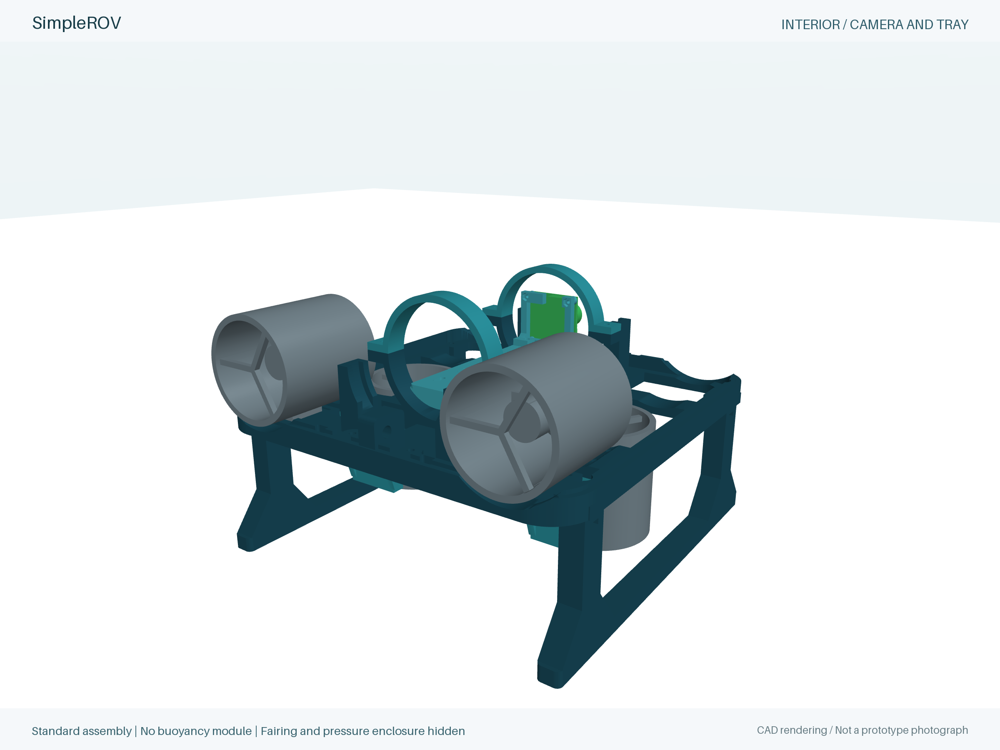

内部图隐藏上罩与压力舱组件，展示已有相机、托板和机架关系。图中空出的空间不是“所有电子设备已装得下”的证明。

## 浮力模块为什么是选装

标准装配便于先做机械试装、确认推进器接口和测量整机重量。之后可以根据电池、电子模块、线束和实际排水量选择浮材，不把顶部两块浮材固定成每台机器都必须安装的部分。

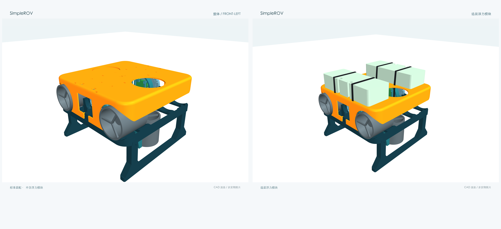

| 配置 | 默认安装 | CAD 总装 |
|---|---|---|
| 标准配置 `base` | 不安装浮材与绑带 | [simple-rov.step](mechanical/assemblies/simple-rov.step) |
| 浮力模块配置 `with-buoyancy` | 在标准机体上增加两块浮材和四条绑带 | [simple-rov-with-buoyancy.step](mechanical/assemblies/simple-rov-with-buoyancy.step) |

现有浮材参考为前后两块闭孔材料，每块名义尺寸 62 × 160 × 35 mm。它们是采购后切割的材料，**不需要和上罩一体打印**。BOM 中浮材和绑带的默认数量为 0，选装数量单独列出。

是否可以不装浮材，要在完整装机后称重、测排水量并试水判断。默认不安装不代表裸机已具备正浮力，也不保证断推后上浮。材料尺寸、位置和配重都应按实际配平调整。[浮力模块与配平说明](docs/buoyancy.md)。

## 获取文件

| 文件 | 位置 |
|---|---|
| 默认完整总装 | [mechanical/assemblies/simple-rov.step](mechanical/assemblies/simple-rov.step) |
| 默认总装，含名义紧固件 | [simple-rov-with-fasteners.step](mechanical/assemblies/simple-rov-with-fasteners.step) |
| 选装浮力模块总装 | [simple-rov-with-buoyancy.step](mechanical/assemblies/simple-rov-with-buoyancy.step) |
| 10 个独立打印件 | [mechanical/stl/](mechanical/stl/) |
| 10 个独立可编辑实体 | [mechanical/step_parts/](mechanical/step_parts/) |
| 两个电机接口试片 | [mechanical/fit_coupons/](mechanical/fit_coupons/) |
| 参数化结构源 | [build.py](mechanical/build.py) · [parameters.json](mechanical/parameters.json) |
| 装配说明 | [图文说明](docs/assembly.md) · [PDF](docs/assembly.pdf) |
| 打印、螺丝与采购清单 | [bom/](bom/) |
| 具体配置、尺寸和部件列表 | [configurations.json](mechanical/configurations.json) |

文件名中的既有零件编号保留，方便对照孔位和已有打印资料。默认与选装总装使用同一套 10 个主体打印件。

## 从打印到首次下水

1. **核对电机接口。** 先用一台实物推进器和两个试片检查孔距、底脚、孔深与出线，确认后再打印主体。
2. **确定舱内摆放。** 收集电池、四路电调、控制器、相机主机、连接器及线束的真实尺寸，先完成 1:1 试装。
3. **安装机械骨架。** 底架与滑橇先装，再装竖推支架、四台推进器和中央舱。
4. **安装干舱模块。** 控制板通过适配安装板和绝缘隔柱固定到托板；电机线经合适的密封穿舱件进入舱内电调。
5. **验漏与配平。** 使用真实接头和堵头测试空舱，装齐负载后确定是否需要浮材和配重。
6. **浅水低功率验证。** 在可随时回收的场地逐台核对推力方向，再调试升降、转向、定深和失联停推。

完整的螺钉方向、垫片位置、装配顺序和停点见 [组装说明](docs/assembly.md)。制造与验收条件见 [装配验收](docs/acceptance.md) 和 [实机路线](docs/build-plan.md)。

## 运行 MuJoCo

推荐 Python 3.12。从仓库根目录安装依赖：

```bash
git clone https://github.com/tianrking/simple-rov.git
cd simple-rov
python3 -m venv .venv
source .venv/bin/activate
python -m pip install -r requirements/sim.txt
```

Windows 激活命令为 `.venv\Scripts\activate`。Mac 安装依赖后也可双击 `launch-macos.command`。

启动默认、不带浮材的键盘驾驶：

```bash
python simulation/mujoco/run.py --viewer --manual --seconds 300
```

查看带选装浮力模块的装配：

```bash
python simulation/mujoco/run.py --viewer --manual --configuration with-buoyancy --seconds 300
```

| 操作 | 按键 |
|---|---|
| 前进 / 后退 | 按住 W / S，松开取消前后推力 |
| 左转 / 右转 | A / D，每次调整航向目标 15° |
| 上升 / 下降 | U / J，每次调整目标深度 0.1 m |
| 保持当前深度和航向 | X |
| 旋转视角 / 缩放 | 鼠标左键拖动 / 滚轮 |
| 退出 | Esc 或关闭窗口 |

驾驶窗口独立处理按键，不使用 MuJoCo 自带查看器的字母热键。窗口失焦后取消前后推力；取消推力仍可能有惯性滑行。

离线自动演示与录像：

```bash
python simulation/mujoco/run.py --render --output-dir runs/demo
```

`runs/demo/` 中包含录像、状态 CSV 和图像。省略输出目录时，程序创建带 UTC 时间戳的运行目录。

### 仿真计算什么

模型包含当前 CAD 外观、刚体质量与惯量、四个真实位置的推力作用点、Python 浮力和阻力、电机响应延迟，以及定深、定向和横滚的经典反馈控制。坐标、推力单位和控制分配见 [仿真说明](docs/simulation.md)。

**质量、重心、浮心、排水量、阻力和反向推力目前是示例参数。** 切换浮材装配只改变可见几何和对应碰撞体，不会自动根据材料计算净浮力或重心。两种装配都需要实测标定后才能用于性能比较。

当前已增加可配置水流、简化系缆张力、推进器故障、传感器接口与受限推力分配；尚无海浪、自由液面穿越、分布式线缆、CFD 或真实水下成像。只打开 XML 不会执行 Python 中的水下外力，正常运行请使用 `run.py`。

### 在代码中使用控制接口

```python
from simulation.mujoco.environment import ROV

rov = ROV(configuration="base")
for _ in range(1000):
    forces = rov.controller(depth=1.2, surge_N=2.0, yaw=0.0)
    position, attitude, velocity, angular_velocity = rov.step(forces)
```

`step()` 的四个输入依次对应水平左、水平右、竖直左、竖直右，单位为牛顿，不是 PWM 或电机转速。实机首先采用经典控制完成遥控与稳定，再考虑自主任务或强化学习；仿真基座使用 MuJoCo 4.0.1，并提供通过检查的 Gymnasium 1.4.0 接口；没有训练好的策略或可烧录固件。[仿真基座详细说明](docs/simulation-foundation.md)。

## 修改结构与复建

```bash
python -m pip install -r requirements/cad.txt
python mechanical/build.py
python mechanical/build_fit_coupons.py
python mechanical/verify.py
python mechanical/export_metadata.py
python mechanical/verify_configurations.py
python simulation/mujoco/build_model.py
python simulation/mujoco/verify.py
python simulation/mujoco/verify_manual.py
```

CAD 构建会同时输出标准和选装装配。修改推进器时，应同时核对外形、安装面、孔距、孔深、出线、桨水路和螺钉长度，不能只改孔距。CAD、BOM、装配文档和仿真应保持同一版本。[开发说明](docs/development.md)。

## 目录结构

```text
mechanical/          参数化 CAD、独立零件、两种总装、原厂参考和几何检查
simulation/mujoco/   水下受力模型、经典控制、键盘驾驶和验证
bom/                 默认及选装物料、打印清单、接口记录
electronics/         后续 KiCad 项目与机械接口约束
firmware/            后续实机固件与失效处理要求
docs/                装配、设计、配平、仿真、开发文档和多视角图像
tools/               图像与文档生成、检查、清单和打包工具
validation/          检查记录；历史 Onshape 回导记录单独保存
requirements/        按用途固定的 Python 依赖
runs/                本地运行结果，默认不提交
```

## 当前状态

| 内容 | 状态 |
|---|---|
| 参数化机械结构、10 个打印件与两种装配 | 已提供，可开始接口与机械试装 |
| 装配说明、机械 BOM、孔位表 | 已提供；电机孔深需实物确认 |
| MuJoCo 及经典控制示例 | 已提供，水动力参数待标定 |
| 完整电子模块摆放、托板锁止、穿舱线束和散热 | 待确定 |
| PCB、实机固件 | 后续开发目录已预留，尚未实现 |
| 实物装配、承载、水密、配平与下水测试 | 尚未完成 |

自动检查用于验证文件、几何与程序的一致性，不代表整机通过了可靠性或潜深认证。[检查流程](.github/workflows/verify.yml) · [详细状态](STATUS.json) · [路线图](docs/roadmap.md) · [变更记录](CHANGELOG.md)。

## 权利与第三方资料

本仓库公开展示，原创内容保留全部权利，暂未授予开源许可。第三方 CAD、厂家图纸及依赖保留原作者权利。[LICENSE](LICENSE) · [第三方说明](THIRD_PARTY_NOTICES.md) · [资料来源](SOURCES.json)。
