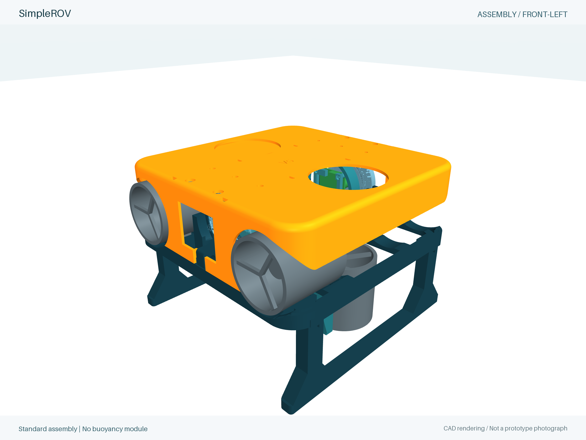
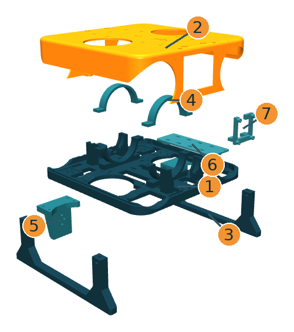
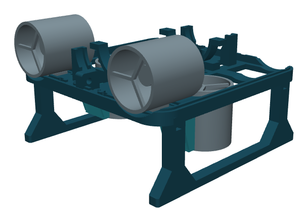
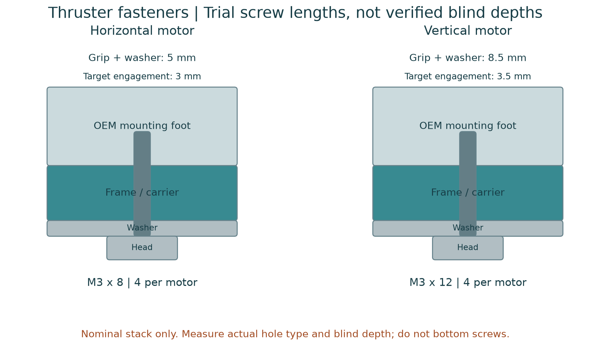
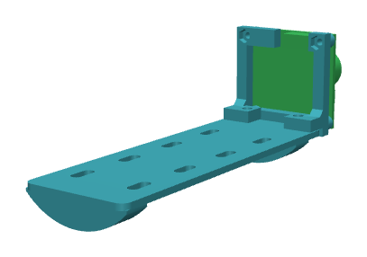
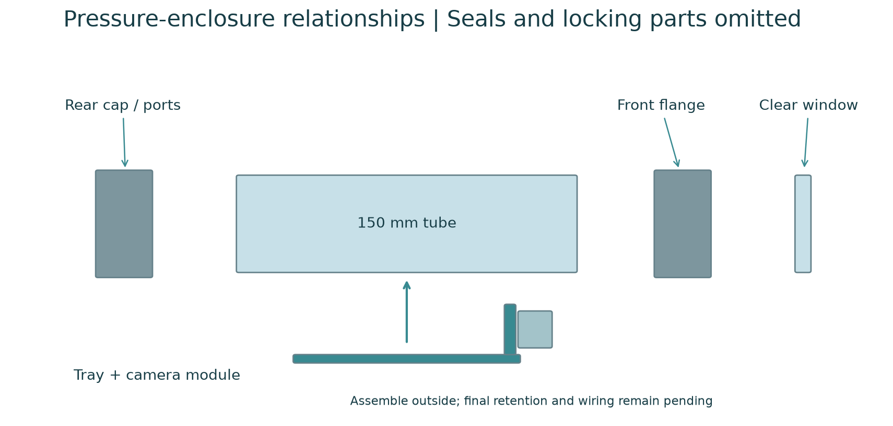
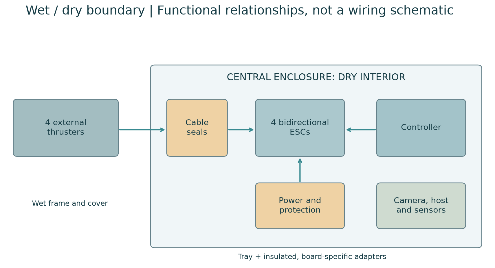
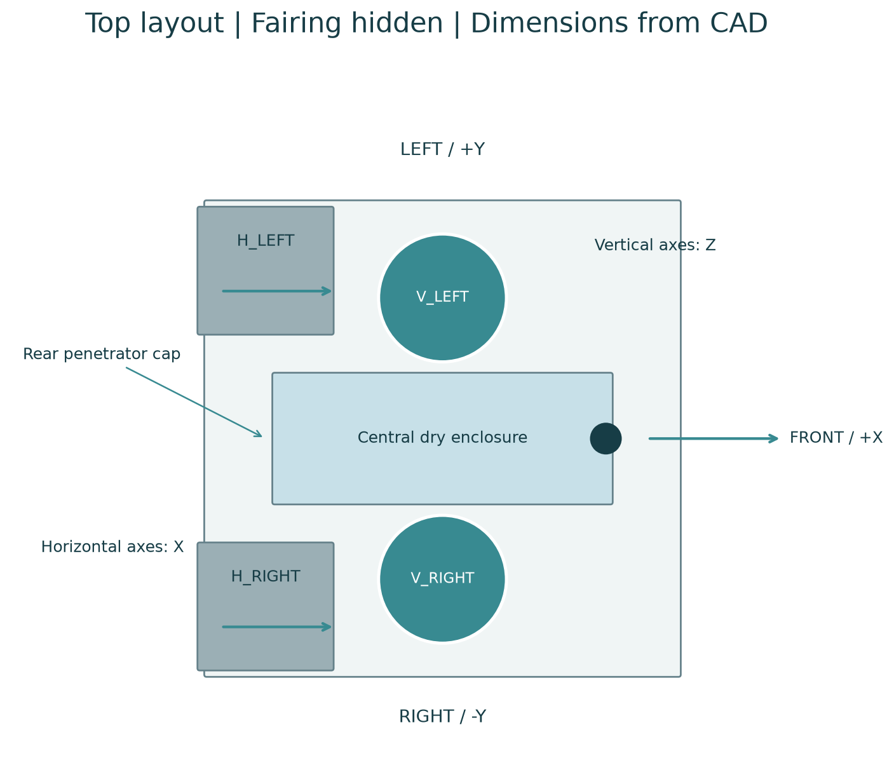

# SimpleROV illustrated assembly guide

Standard assembly and optional accessories. [PDF](assembly.pdf) · [Acceptance](acceptance.md) · [Prototype plan](build-plan.md)

## 01 Meet the vehicle

SimpleROV / Illustrated assembly guide / 2026-11-14

Figure 1. Standard CAD assembly without optional foam or straps. Final electronics, penetrators and wiring are not shown.

SimpleROV has four thrusters around a central dry enclosure. The standard envelope is about 213 x 210 x 148 mm; the reference buoyancy module increases height to 184.7 mm. Two horizontal thrusters provide forward/reverse and differential yaw. Two side-by-side vertical thrusters provide ascent/descent and differential roll correction. Sway and pitch are not independently actuated.

The frame, fairing, skids and complete commercial thrusters operate wet. The central compatible commercial enclosure keeps electronics dry. The fairing freely floods: it is not a waterproof box. Buy the motor, propeller and duct as one complete waterproof thruster; do not print the propeller or make a rotating shaft penetration.

> Status: digital geometry and mesh checks are available. Physical motor fit, print load capacity, wet retention, sealing and complete electrical packaging remain unverified. Board adapters, positive axial tray retention and final penetrator wiring are pending. This is not a depth or reliability certification.

Reading order: parts on page 2; screws on page 3; frame and motors on pages 4-5; camera, enclosure and wiring on pages 6-8; cover and optional buoyancy on page 9; acceptance and service on page 10; files and records on page 11.

## 02 Identify the printed parts

10 main prints / 7 functional types / 2 additional motor-fit coupons

Figure 2. Exploded identification view from the actual print meshes. Offsets help identify parts; they do not prescribe a removal direction.

|ID / filename prefix|Qty.|Purpose and location|
|---|---|---|
|1 / V5_01_LOAD_CHASSIS|1|Load frame joining motors, skids, enclosure and fairing; includes tether eye and optional strap routes.|
|2 / V5_02_UPPER_FAIRING|1|Protective orange cover with flooding/flow openings, camera opening and four screw wells. Not a lifting handle or pressure vessel.|
|3 / V5_03_SKID|2|Side skids with two legs each; bench/floor support and underside protection.|
|4 / V5_04_POD_CLAMP|2|Fore/aft tube clamps; use soft liners to retain the enclosure, not to seal its endcaps.|
|5 / V5_05_VERTICAL_CARRIER|2|Vertical motor carriers: 8 mm main wall, two ribs and four chassis connections per side.|
|6 / V5_06_MODULE_TRAY|1|100 x 35 mm internal tray for camera and future modules; board adapter and positive axial retention are pending.|
|7 / V5_07_CAMERA_CARRIER|1|Camera-board mount with lens/USB clearance and nut pockets; attaches to the tray.|

Print from mechanical/stl/: files are in mm and bed-oriented. mechanical/assembly_meshes/ is for assembly and simulation, not print orientation. Buy the enclosure, camera and thrusters separately. Foam and straps are optional purchases, absent by default.

## 03 Fasteners and tools

Installed quantities only / verify motor blind depths before selecting screw lengths

|Specification|Qty.|Allocation|
|---|---|---|
|M3 x 8 socket-head screw|8|Horizontal motors: 4 each; target trial engagement 3 mm.|
|M3 x 12 socket-head screw|10|Vertical motors: 4 each; camera carrier to tray: 2.|
|M3 x 16 socket-head screw|8|Skids: 4; tube clamps: 4.|
|M3 x 20 socket-head screw|8|Vertical carrier feet to chassis: 4 each.|
|M3 x 25 socket-head screw|4|Fairing to chassis.|
|M3 hex nut, AF5.5 x 2.4 mm|22|Skids 4; clamps 4; carrier feet 8; fairing 4; camera-carrier foot 2.|
|M3 washer, OD7 / ID3.2 / t0.5 mm|56|Skids 4; clamps 8; carrier feet 16; motors 16; fairing 8; camera-carrier foot 4.|
|M2 x 10 screw|10|Camera 4; OEM transparent window 6, preferably supplied in its kit.|
|M2 hex nut, AF4 x 1.6 mm|4|Rear camera-carrier pockets.|
|M2 washer, OD5 / ID2.2 / t0.3 mm|4|Camera-board front only; do not add to the OEM window screw stack.|

M3 x 12 means nominal 3 mm thread diameter and 12 mm length under the head. AF is nut width across flats. Nominal hardware references are A4-70 for M3 and 316 stainless for M2; supplier pressure-hardware requirements take precedence. Quantities exclude spares and must not duplicate screws already in the enclosure kit.

Tools: long hex drivers matched to the actual heads, suitable M3/M2 nut tools, calipers, blind-depth gauge, deburring tools, a flat bench, labels, compatible seal-cleaning materials and supplier-approved lubricant. Later stages require a meter, current-limited bench supply, leak-test tools and a recoverable shallow-water site.

> No universal torque or locking process is specified. Do not apply metal-joint torque assumptions to printed parts or acrylic windows. Confirm seal/plastic compatibility and supplier approval before using locking chemicals.

## 04 Assemble the frame

Dry bench assembly / power disconnected

Figure 3. Frame and propulsion layout with fairing, buoyancy and central enclosure hidden. Motors are reconstructed commercial references, not prints.

0. Test one real motor with H_mount_fit and V_mount_fit first. Confirm all four M3 interpretations, 14/8 mm cross orientation, hole depths, foot contact and cable exit. Horizontal effective grip plus washer is about 5 mm; vertical grip plus washer about 8.5 mm. Do not batch-print the main parts before this check.

1. Remove supports, burrs and strings. Initial settings: PETG, 0.2 mm layers, at least six walls and solid load paths. Inspect layer separation, warping, holes and nut pockets. The largest bed footprint is about 210 x 210 mm. Test fastener passage without forcing warped parts into alignment.

2. Identify the front by the camera and the rear by the tether eye. X points forward, Y left, Z up. Left/right are defined while facing forward with the vehicle.

3. Fit skids beneath the chassis at Y = +/-97 mm. Load M3 nuts through the side openings. Insert four M3 x 16 downward from above, with one washer under each head. Total: 4 screws, 4 washers, 4 nuts. Align before tightening progressively.

4. Place vertical carriers at Y = +/-62 mm. Per side, insert four M3 x 20 upward through the foot flange and chassis, with washers above/below and nuts above. Total: 8 screws, 16 washers, 8 nuts. Ribs face the rear mounting side and must not enter the vertical flow corridor.

> Check flat skid support and full carrier seating without bending parts into place. Horizontal motors obstruct the upper skid tool paths, so install skids first.

## 05 Install the four thrusters

Complete waterproof motors, propellers and ducts / independent bidirectional ESC per motor

Figure 4. Nominal motor screw stacks and engagement targets. The OEM foot geometry and blind depths require physical verification.

5. Horizontal motors: axes (-78, +/-74, 18) mm, along X. Seat each OEM foot on its chassis mounting pad. Install four M3 x 8 and four M3 washers upward from below per motor. Washers sit in recessed seats. Do not clamp the rotor, propeller shaft, blades or thin duct wall.

6. Vertical motors: axes (0, +/-62, -40) mm, along Z. Seat the OEM foot against the carrier mounting face. Insert four M3 x 12 and four washers per motor from the back of the carrier along X. Confirm orientation against the assembly and Figure 8 top-layout diagram.

7. Use an opposite-handed commercial pair for each axis where available. Calibrate signs so common horizontal force moves forward and common vertical force moves upward. CW/CCW alone does not define command polarity. Each motor requires its own compatible bidirectional ESC; verify directions submerged at low thrust.

8. Route motor wires along the chassis with service slack and provisional releasable ties. Keep all wires clear of propellers, cover pinch points and flow paths. OEM cable-exit geometry is incomplete in the model and must be checked against actual motors.

> Release gate: screws do not bottom, feet sit flat, motors cannot shift and propellers have clearance. The D54 mm geometric corridor is not a validated flow-efficiency result. Nominal M3 x 8/12 lengths do not replace depth measurement.

## 06 Camera, tray and controller

Camera mount modeled / board adapter and positive axial tray retention still required

Figure 5. Existing camera/tray module. Video host, MCU, four ESCs, battery and final USB plug are not included in this view.

9. Place four M2 nuts in the carrier rear hex pockets. Align the camera 28 x 28 mm pattern, lens forward. Fit an M2 thin washer at each front hole, then four M2 x 10 screws. Do not bend the PCB with screw preload.

10. The camera board is rotated 180 degrees about the optical axis so USB enters the upper relief. Rotate acquired images 180 degrees in software. Verify the real plug, removal and cable-bend space; no final plug or elbow is selected.

11. Align the carrier feet with tray holes at X = 42, Y = +/-10 mm. Two M3 x 12 enter downward; fit washers under heads and below the tray, then nuts. Total: 2 screws, 4 M3 washers, 2 M3 nuts. Assemble outside the enclosure.

12. Keep ordinary MCU/controller boards dry. Mount each on a board-specific insulated adapter using suitable standoffs, then attach the adapter to the tray slots. Eight 8 x 3.4 mm slots are centered at X = -40/-20/0/20, Y = +/-10 mm. Do not drill the pressure tube to hold electronics.

13. Two curved tray feet with soft pads provide provisional fit retention only. Add and validate positive axial retention against wiring pull and impact. Its form depends on the final enclosure and available interfaces; it is not yet modeled.

> Hold point: do not seal a complete powered payload until board adapters, tray retention and full-scale battery/ESC/controller/video-host/connector placement have been checked. A 150 mm tube designation does not prove that everything fits.

## 07 Pressure enclosure and clamps

Commercial seals keep the interior dry / printed clamps retain only the outer tube

Figure 6. Enclosure relationship diagram, not a seal-groove section or manufacturing drawing. Seals, locking cords and final wiring are omitted.

14. Obtain a compatible 150 mm tube, front RAILS flange/window, rear 1 M10 + 8 M6 flange cap, and matching seals, locks, plugs and penetrators. The reference tube OD is 58 mm; the label "50 mm" alone does not establish compatibility.

15. Follow the supplier process for cleaning, inspecting and lubricating seals. Align locking entries with tube cutouts. Use the OEM six M2 x 0.4-10 window screws and original stack, without added washers. Do not apply general M3 joint torque assumptions to this assembly.

16. Assemble the tray module and removable wiring outside the tube. Insert without crowding sealing surfaces. Install final electronics only after the complete empty enclosure, connectors and wiring pass leak checks. Prefer the supplier endcap-service method rather than repeatedly dismantling the acrylic window.

17. Place about 1 mm thick, 12 mm wide closed-cell EPDM in each lower saddle, cut to actual circumference with a butt joint and no overlap. Nominal compressed radial allowance is about 0.8 mm. Measure compression and seating; this liner is not a seal.

18. Seat the tube in both saddles. Chassis end slots receive the metal flange projections for axial restraint, with about 0.6 mm nominal axial clearance. Do not load the acrylic window, seal grooves or lock entries, or force an endcap into the slot.

19. Fit upper clamps at X = +/-50 mm. Four M3 x 16 enter downward with washers under heads and below the chassis, then nuts: 4 screws, 8 washers, 4 nuts. Stop at the clamp hard stops; do not crush the tube to prevent slip.

> Leak-test the complete compatible system per supplier instructions. Its vacuum guide describes about 15 inHg, 10-15 minutes and no more than 0.5 inHg loss for an applicable setup. Confirm applicability and tool integrity first. Vacuum acceptance is not operating-depth certification.

Supplier guides: bluerobotics.com/learn/watertight-enclosure-wte-assembly-new/ and bluerobotics.com/learn/using-the-vacuum-test-plug/.

## 08 Wiring and the wet/dry boundary

System relationship only / not a frozen schematic or production harness

Figure 7. Thrusters and frame are wet. ESCs, controller and other ordinary electronics belong in a verified dry enclosure.

20. Connect each three-phase brushless motor to one matched bidirectional ESC. The controller sends the selected control signal to each ESC; motors do not connect directly to MCU pins. ESCs, power protection, regulation and signal protocol remain unselected.

21. Pass motor cables through penetrators suited to their real construction, outside diameter and jacket material. Loose conductors or multiwire bundles do not automatically seal in a single-cable compression gland. A compatible factory-potted harness may be necessary.

22. Fit compatible penetrators in used ports and matching plugs in every unused port. Assemble sealing interfaces per supplier requirements. The rear 1 M10 + 8 M6 pattern is port capacity, not proof of connector compatibility or a completed waterproof harness.

23. Leave service slack and provide strain relief without contacting propellers, sharp edges, seals or locks. Do not pinch wires in the endcap. Terminate the independent tether load path at the rear 6 mm eye; its recovery load is untested. Do not load penetrators, conductors or the camera USB lead in tension.

24. Before closure, confirm battery/protection, controller, four ESCs, regulator, USB host, sensors, connectors and service space. The USB camera requires a suitable host to receive video. An MCU PWM output does not provide a video host.

> Waterproofing belongs to the complete enclosure, penetrators and cable system. An ordinary MCU can operate inside a proven dry enclosure. Full electrical packaging, wiring, protection and heat management remain pending; this relationship diagram does not replace them.

## 09 Fairing, optional foam and trim

Standard assembly omits top foam and straps / select additions from measured trim

Figure 8. Top layout with the cover hidden. Horizontal arrows indicate the positive force convention, not water flow.

25. Seat the fairing locating lip. Four tool wells align with X = +/-95, Y = +/-18 mm connections. Insert four M3 x 25 from above, washers under heads and below the chassis, then nuts: 4 screws, 8 washers, 4 nuts. Do not pinch wires in the lip. It is not a sealing surface.

26. Optional only: place two nominal 62 x 160 x 35 mm closed-cell foam pieces fore/aft, centered X = +/-69 mm, bottom Z = 60.5 mm. Select a material for the intended depth and actual density, not hollow FDM or absorbent foam. Four nominal D12 tool reliefs must preserve screw-well access.

27. Optional with foam: run four releasable straps along X around foam and load chassis at Y = +/-32.5 mm. Rear guides: X = -101/-35; front guides: X = 35/101 mm; slots 3 x 7 mm. Reference band 4.8 mm wide, at most 1.2 mm thick and about 450 mm long. Buckles are unmodeled; keep them accessible on top and clear of tools and propeller flow.

28. Skip steps 26-27 for the standard assembly. Weigh the complete vehicle and measure displacement and submerged attitude. Add suitable foam or engineered ballast through the two bottom 12 x 3.4 mm slots as required. Establish CG below CB, fore/aft balance and a measured slightly positive submerged trim. Simulation values of 1.4 kg and 1% positive buoyancy are assumptions, not measurements.

## 10 Inspection and service

Dry fit and empty-enclosure checks before recoverable, low-power shallow-water trials

|Gate|Check|If incomplete|
|---|---|---|
|Dry fit|Fasteners accessible; motors, tube, camera and tray retained; wiring clear of propellers and lips.|Correct gaps, blind depths, retention and routing before closure.|
|Physical loading|Test actual prints, carriers, clamps and tether eye, including wet retention.|Digital checks cannot provide a physical load rating.|
|Empty enclosure|Real penetrators, plugs and harness assembled and tested by the compatible supplier procedure.|Do not immerse powered electronics.|
|Unpowered trim|Representative final mass; fully submerged net buoyancy, attitude and fore/aft balance.|Adjust mass/foam rather than using control thrust to mask static trim.|
|Shallow powered trial|Recoverable site, individual signs, loss-of-command stop, ascent/descent, yaw and depth hold.|Keep power and depth bounded; investigate before expanding tests.|

The acceptance plan proposes about 41 N in both directions per motor mounting module, held five minutes and repeated three times. This is an unperformed project test, not a certification standard. Use a rigid substitute fixture at the motor thrust axis. Displacement must remain below half the actual minimum gap; inspect cracks, layer separation, slip and residual deformation. Whole-frame combined loads and actual material properties require separate validation.

Service sequence: disconnect power and prevent motor start; if foam is installed, release straps and remove foam; remove the cover through its four wells; release clamps and service the enclosure per supplier instructions. Remove obstructing horizontal thrusters before skid service. Vertical motor side screws can be serviced independently.

After use inspect moisture, cable wear, penetrators, print layers and nut pockets. Repeat leak checks after seal or penetrator changes. Reassess components after bottom strikes, collision, overheating or water ingress.

> No full-power endurance, service-life or depth rating is claimed. Remaining work includes positive tray retention, complete electrical space/heat assessment, penetrator wiring, actual motor interfaces and all physical trials.

## 11 Files and build records

Keep prints, purchased revisions and test evidence tied to the same vehicle revision

|Need|Repository location|
|---|---|
|Ten main prints|mechanical/stl/; IDs correspond to page 2.|
|Motor fit coupons|mechanical/fit_coupons/H_mount_fit.stl and V_mount_fit.stl.|
|Editable structure|mechanical/step_parts/; source mechanical/build.py and parameters.json.|
|Assembly variants|mechanical/assemblies/: simple-rov.step is standard; filenames with buoyancy or fasteners identify the other variants.|
|Print / fastener quantities|bom/PRINT_MANIFEST.csv; BOM_FASTENERS.csv; FASTENER_INSTANCES.csv.|
|Purchased parts / interfaces|bom/BOM_PURCHASED.csv; KEY_HOLES.csv; mechanical/INTERFACES.json.|
|Prototype and acceptance|docs/build-plan.md; bom/component-confirmation.csv; docs/acceptance.md.|
|Simulation / digital evidence|docs/simulation.md; simulation/mujoco/; mechanical/GEOMETRY_CHECKS.json and EXPORT_CHECKS.json.|

Complete before a finished vehicle: motor hole/depth/cable verification; specific boards and adapters; positive tray retention; full battery/ESC/video-host/wiring layout and heat assessment; actual penetrators/plugs; mass, CG/CB and thrust calibration; printed load/wet retention, sealing and shallow-water trials.

Record vehicle ID, print batch/material, orientation/layers/walls, fastener grade and measured engagement, purchased revisions, actual mass, motor signs/neutral/current, leak-test date/results, load evidence, unpowered trim and service events. A previous print batch does not establish the strength of a new one.

Historical Onshape prints are imported editable solids without native sketch history; Python is the dimension-driven source. The rear supplier cap imported as an open shell; local OEM STEP remains solid. Historical cloud assembly includes optional foam. Current defaults are the repository assemblies; synchronize CAD, hole lists, documents and simulation after changes.

Sources: X2 manufacturer dimensions; attributed Blue Robotics enclosure/camera STEP; supplier enclosure and vacuum guides. Reference motor meshes and diagrams are not OEM manufacturing data. Full source links and rights are recorded in SOURCES.json and THIRD_PARTY_NOTICES.md.

> First physical action: one motor and both fit coupons, alongside a full-scale electrical layout. Only after those pass should the main prints and remaining motors be ordered. STL files and a screw list alone do not establish a mature, validated vehicle.

## Supplier instructions

[Enclosure assembly](https://bluerobotics.com/learn/watertight-enclosure-wte-assembly-new/) · [Vacuum leak testing](https://bluerobotics.com/learn/using-the-vacuum-test-plug/)
