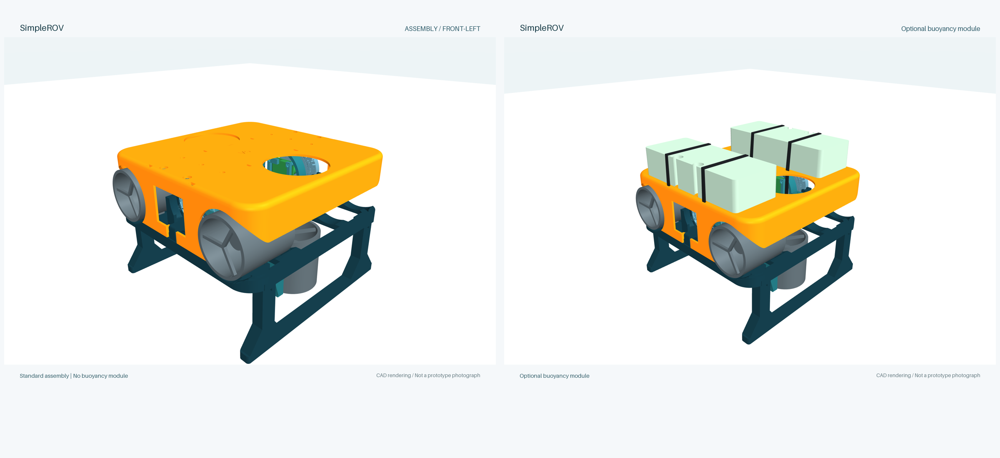

# Buoyancy module and trim

The standard assembly omits top foam and straps. The chassis and fairing retain their mounting routes. Decide whether to add foam after installing the real battery, controller, ESCs, video host, wiring and penetrators, or equivalent representative mass.

| Configuration | Envelope, L × W × H | Foam | Straps |
|---|---|---:|---:|
| Standard `base` | 213 × 210 × 148 mm | 0 | 0 |
| Optional `with-buoyancy` | 213 × 210 × 184.7 mm | 2 | 4 |

Dimensions exclude final cable exits, penetrators, tether fittings, strap buckles and ballast. Both configurations share ten main prints.

## When to add foam

Total real mass determines weight; actual displaced volume determines buoyancy. Freely flooded space inside the fairing is not sealed displacement.

- Add depth-appropriate closed-cell foam or revise components if buoyancy is insufficient.
- Adjust mass and buoyancy distribution for fore/aft and left/right balance. Avoid relying on continuous thrust to correct poor static trim.
- Excess foam increases the continuous downward thrust needed to dive, as well as size and drag.

A slightly positive fully submerged trim is a prototype target, not an established property of this CAD. A foam-free default does not guarantee passive ascent. Check actual displacement and the unpowered attitude in a recoverable shallow-water test.

## Reference installation

Two nominal 62 × 160 × 35 mm blanks sit fore and aft at X = ±69 mm, bottom Z = 60.5 mm. Four nominal D12 tool reliefs preserve fairing-screw access. Four releasable straps run along X at Y = ±32.5 mm through 3 × 7 mm chassis guides at X = -101/-35/35/101 mm. Reference straps are about 450 × 4.8 mm, at most 1.2 mm thick. Buckles are not modeled; place them on top, away from screw wells and flow paths.

The two rectangular blanks total about 0.694 L before cutouts. Actual material density, cutouts, absorption and pressure compression determine useful buoyancy; blank volume is not a supported payload rating. Select a specific foam grade and applicable depth.

For foam alone, an initial estimate is `net buoyancy = (water density - foam density) × actual volume × gravitational acceleration`. Verify the final assembly by measurement.

## CAD and procurement

[BOM_PURCHASED.csv](../bom/BOM_PURCHASED.csv) separates default quantities from optional quantities. [Standard STEP](../mechanical/assemblies/simple-rov.step) · [Optional STEP](../mechanical/assemblies/simple-rov-with-buoyancy.step).

## Simulation boundary

`ROV(configuration="base")` / `--configuration base` is the default. `with-buoyancy` adds the foam appearance and associated collision proxies.

Mass, inertia, CG, CB, displacement and drag are explicit shared example parameters, not material properties derived from CAD. Switching variants does not calculate added buoyancy or altered trim. After physical measurements, update `simulation/mujoco/config.json` and rebuild before comparing performance.
