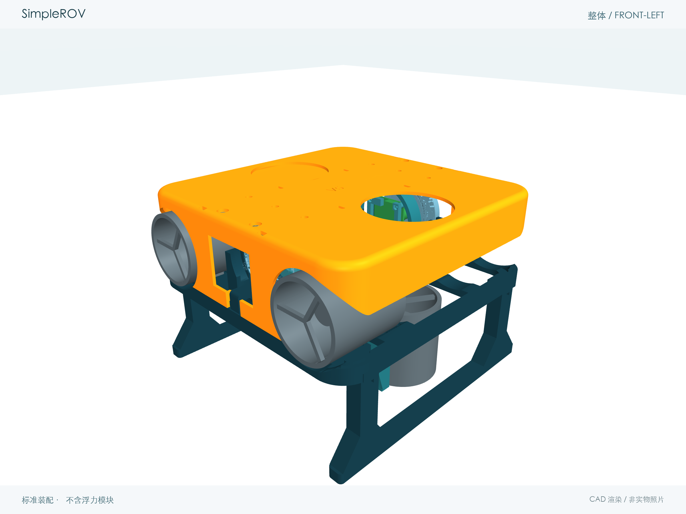

# 结构设计与接口说明

详细图文操作入口：[详细组装说明](assembly.md) · [PDF](assembly.pdf) · [网页](assembly.html)。

当前布局为**两台水平直装＋左右两台竖直推进器**。原创承力框架、保护外罩、推进器支架、相机架、浮材固定和仿真代码均保留源文件。推进器、相机、压力舱及其密封件使用有来源的商用品；本版不自制电机轴封，不设计PCB。

[历史Onshape参考工程](https://cad.onshape.com/documents/256f9be06adfdc472f7aac06/w/aefb43ce726d3d5c24877f23/e/1186baa4f5bb2c01f6be971a)。该云端历史总装含浮材；当前默认配置以本仓库STEP为准。

本版为**可复建、可打印试装、可运行仿真的工程原型**，未经过实物装配、载荷、水密或下水试验。数字通过项不代表物理可靠性或额定潜深。电池、四路双向电调与控制器尚未冻结，本版只提供通用安装空间，不声称完整电气系统已适配。



[MuJoCo 演示录像](../simulation/mujoco/V5_sim_demo.mp4) · [网页阅读版](index.html)

## 布局

坐标X向前、Y向左、Z向上，尺寸单位mm。默认无浮材装配外包 **213×210×148 mm**；选装浮力模块后约 **213×210×185 mm**，不含待选的线缆、穿舱接头、系缆头与配重。

|模块|位置/功能|
|---|---|
|水平左/右推进器|轴心(−78,±74,18)，轴向X；同推前后，差动转向|
|竖直左/右推进器|轴心(0,±62,−40)，轴向Z；同推升降，差动横滚纠偏|
|中央压力舱|150mm管，外径58，轴心Z22；独立承压|
|前视相机|镜头前端约X77.35/Y0/Z22，透明窗前方已留观察通道|
|选装浮材|默认无；需要时前后各一块62×160×35，带四个工具让位孔；由四条纵向绑带固定到承力底架|
|配重与系缆|底部两条M3长圆孔；后部6mm系缆眼与底架一体，未赋予回收额定载荷|

这是一套四输入、欠驱动载具：可控制前后、升降、偏航和横滚；**横移与俯仰不能独立主动控制**。俯仰需要实际浮心/重心配平，前进时也可能出现俯仰耦合。

## 文件入口

- `mechanical/stl/`：10个主体独立STL，已按建议方向落床；均不是整机合并打印。
- `mechanical/step_parts/`：10个主体独立STEP，总装坐标。
- `mechanical/assemblies/simple-rov.step`：默认无浮材、无绑带的结构总装，含商用参考件。
- `mechanical/assemblies/simple-rov-with-fasteners.step`：默认装配加名义金属件；同目录提供两套带浮材的选装总装。
- `mechanical/build.py`、`parameters.json`：可复建源及主要参数。
- `mechanical/fit_coupons/`：两个额外的电机接口试片，不计入10个装机打印件。
- `bom/PRINT_MANIFEST.csv`、`BOM_FASTENERS.csv`、`BOM_PURCHASED.csv`、`INTERFACES.json`：打印、采购和接口资料。
- `mechanical/GEOMETRY_CHECKS.json`、`EXPORT_CHECKS.json`：几何/工具/通道及导出检查。
- `simulation/mujoco/`：MuJoCo模型、可修改环境、控制分配、验证脚本及演示录像。
- [装配与实物验收](acceptance.md)、[仿真使用](simulation.md)、[实机落地路线](build-plan.md)、[样机接口确认表](../bom/component-confirmation.csv)。

## 10个主体打印件

|名称前缀|数量|作用与打印注意|
|---|---:|---|
|V5_01_LOAD_CHASSIS|1|闭合边框、横梁、舱座、轴向限位槽、系缆眼；底面落床|
|V5_02_UPPER_FAIRING|1|自由进排水保护罩，定位沿与4个螺钉井；顶面朝下，需要局部支撑|
|V5_03_SKID|2|左右滑橇与加强立腿，侧躺打印|
|V5_04_POD_CLAMP|2|两处舱压环，端面落床，配软衬|
|V5_05_VERTICAL_CARRIER|2|8mm壁厚、双肋、四点连接；电机安装面朝下，法兰外耳局部支撑|
|V5_06_MODULE_TRAY|1|通用内部托板，带模块长圆孔和相机架连接孔|
|V5_07_CAMERA_CARRIER|1|相机、USB让位、M2螺母窝；小件需局部支撑|

建议PETG、0.2mm层高，承力件使用充分实心区域与至少6道壁。100%填充也不能消除打印方向、欠挤出或层间缺陷。先打印接口试片核对电机，再切片主体；检查支撑可拆性、螺母窝、长圆孔和定位沿。最大主体打印平面约210×210mm，220mm打印机需核对实际有效行程和裙边/底座设置。

## 商用接口

**推进器：4台APISQUEEN X2，水平一对、竖直一对，各对优先相反旋向。** 外形参考厂家D56.38、轴向60和14/8十字孔图。当前按四个M3孔解释，安装面偏距31由图纸推得；没有OEM X2 STEP，三维导流罩/桨是尺寸重建示意。全部四孔孔型、有效深度、孔心到端面的精确位置和出线范围仍需样件确认。H用M3×8、V用M3×12分别以约3/3.5mm啮合作试装目标，不能未经量孔深直接旋到底。

**相机：Blue Robotics Low-Light HD USB Camera，32×32、28×28孔距、2.44mm孔。** 已用原厂STEP检查相机板、镜头和USB线接口与原创支架的关系。板绕光轴旋转180°，让USB线接口位于上侧；采集端需要将原始图像旋转180°。本版没有选择USB线的具体插头/弯头，需用实际线件核对插拔和弯曲空间。

**压力舱：Blue Robotics 50mm系列150mm管＋前RAILS法兰/透明端盖＋后1个M10＋8个M6口法兰盖。** 原厂STEP只做刚体变换；锁止入口已与管体缺口对齐，透明盖六孔也已对齐。前透明盖按厂家6颗M2×0.4−10螺钉。密封圈、锁止绳、端口堵头及最终穿舱件按原厂整套采购/装配；不从几何模型推导整机潜深。

**选装浮材：默认不安装，按实测配平需要增加。** 方案为两块名义62×160×35的闭孔浮力材料切割件。** 需要选适合目标水深的材料，按真实密度计算净浮力；不是普通打印塑料块。四条约450×4.8mm绑带沿纵向绕过框架，带宽/厚度须匹配3×7槽。模型未包含实际绑带锁头，锁头放在可达的顶部，远离螺钉井。厚度与配重必须称重后调整，未完成实际配平。

## 编辑与复建

Onshape中10个主体打印件为可直接编辑的导入实体，**不含原生草图特征历史**。完整尺寸驱动源为`mechanical/build.py`。云端整机采用整组Part Studio刚性插入并固定底架。云端回导检查中，商用后端盖转换为未缝合的480面曲面参考（位置/包围盒一致），其余29个为实体；本地原厂STEP及本地结构总装保留该端盖实体。不得用云端曲面参考作为承压零件制造数据。10个原创打印件的云端回导尺寸和体积均通过检查，详见`validation/onshape/ONSHAPE_ROUNDTRIP.json`。主要尺寸、两组推进器位置、孔距与舱夹孔径集中在`parameters.json`；局部结构仍有明确的固定设计尺寸，修改后必须重新生成并检查。Onshape直接编辑不会自动反写Python；修改后应统一更新源文件、孔位表、总装和仿真，保持版本一致。

更换电机时，除了孔距，还需替换真实外形、固定面偏距、轴向孔心、出线范围和螺钉；重新核对水路及工具通道。供货压力件不得直接缩放。

Python虚拟环境中安装`requirements/cad.txt`与`requirements/sim.txt`后，可完整复建：

```bash
python mechanical/build.py
python mechanical/build_fit_coupons.py
python mechanical/verify.py
python mechanical/export_metadata.py
python simulation/mujoco/build_model.py
```

Mac可双击根目录`launch-macos.command`启动键盘驾驶窗口（按住W/S前后、A/D转向、U/J升降、X保持深度/航向）；键盘模式使用独立GLFW窗口隔离热键；松开W/S或窗口失焦后取消前后推力。自动演示所需的uv动态库兼容修复保留在`simulation/mujoco/launch_macos.py`。MuJoCo的运行与测试见[仿真使用](simulation.md)。完整SHA256清单用于识别同一套CAD、仿真与文档文件；重新生成后旧校验清单需要重建。

选装细节见[浮力模块与配平](buoyancy.md)，全部角度见[图库](gallery.md)。
