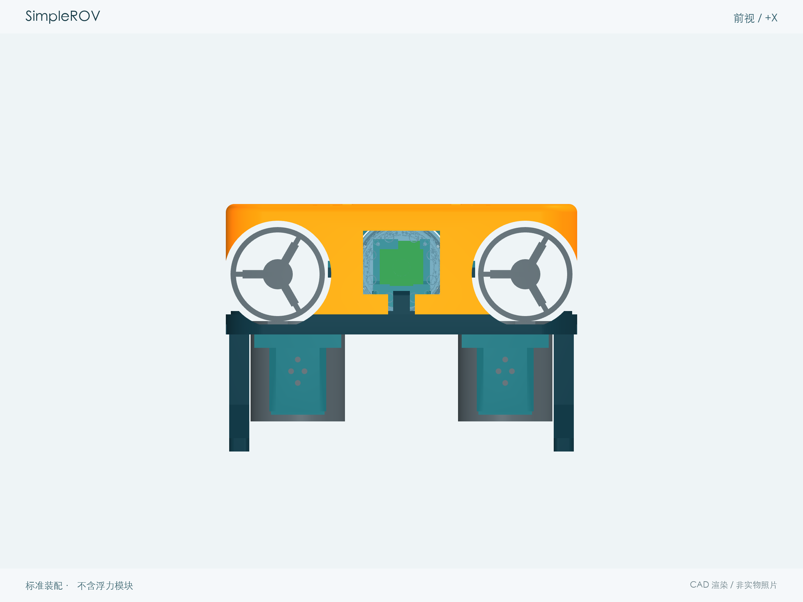
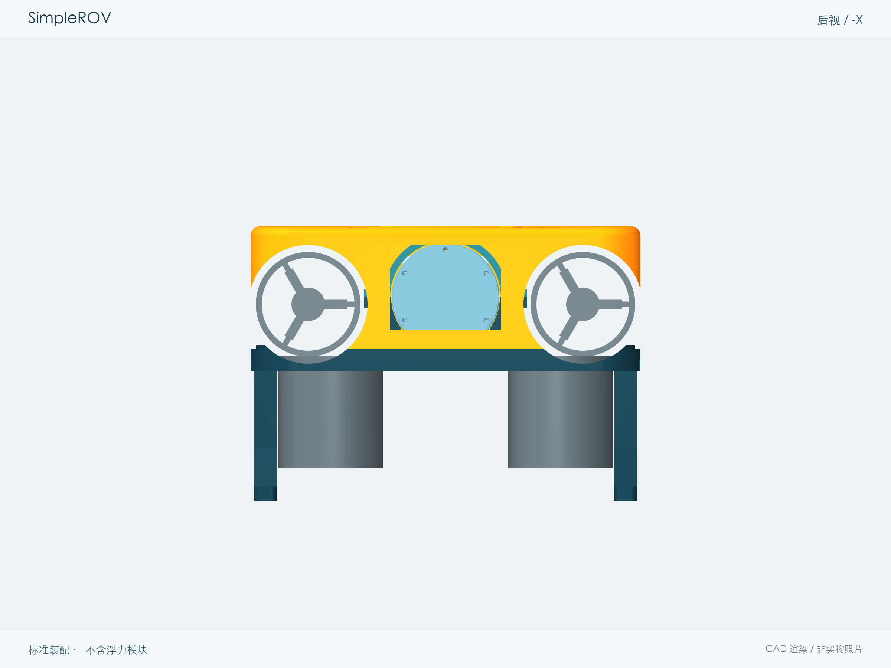
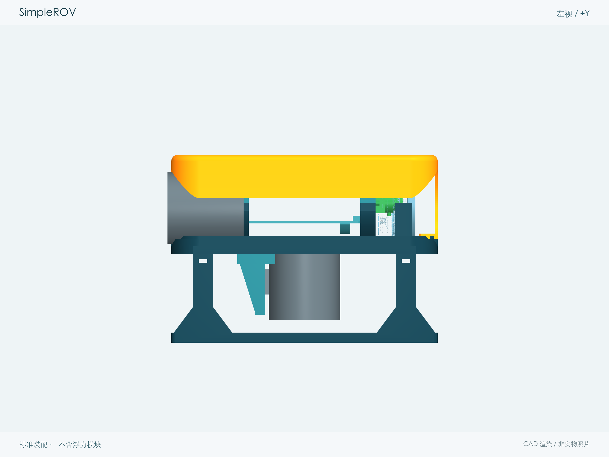
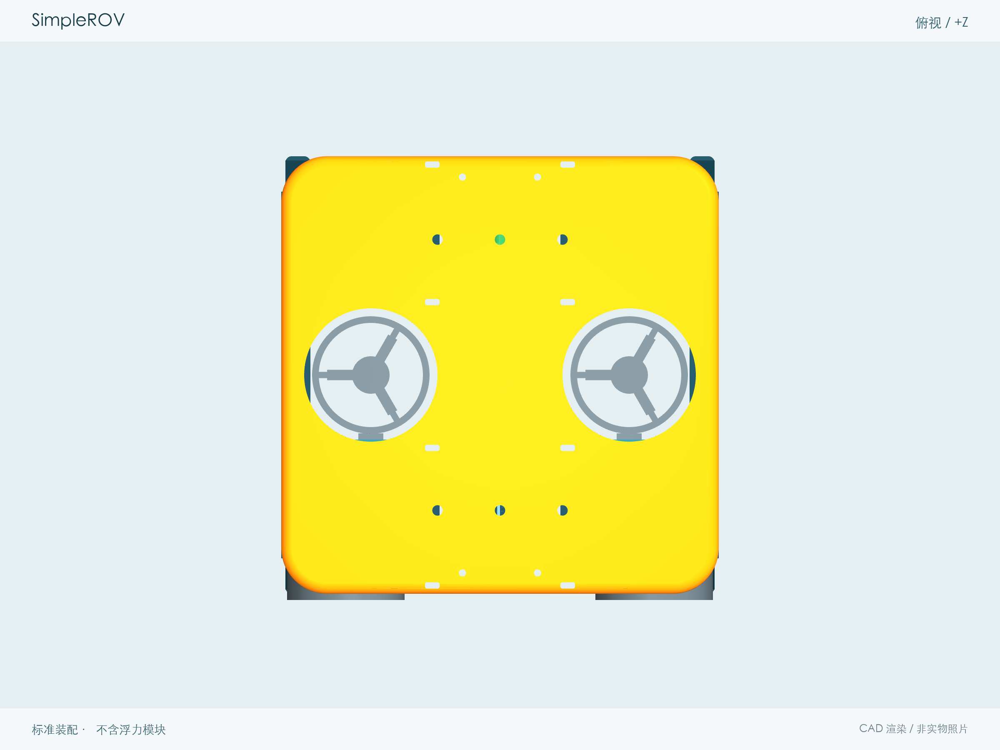

# 结构视图

本页图片直接由当前CAD网格生成，分辨率为2400×1800。标准机体不安装浮力模块。正投影视图使用统一视野，坐标X向前、Y向左、Z向上。

这些是结构渲染图，不是实物照片。舱件采用不透明显示材质便于辨认轮廓，颜色不作为采购或材料规格。推进器为厂家尺寸重建参考，相机和舱件来自注明来源的商用CAD。未完成的控制板、电调、电池和线束没有用虚构模型填充。

## 整体

## 前视与后视

## 左视与右视

## 俯视与底视

## 内部安装

为便于观察，此视图隐藏了上罩与全部压力舱组件，保留相机、托板、机架与推进器。最终电子布局和托板锁止仍需补完。

## 可选浮力模块

浮材是根据实际重量和配平选择的附件，不属于标准装配。安装方法与边界见[浮力模块说明](buoyancy.md)。

## 图像来源

生成脚本：[render_gallery.py](../tools/docs/render_gallery.py)。模型来源、配置、视角和图像哈希记录在[gallery.json](../validation/gallery.json)。
