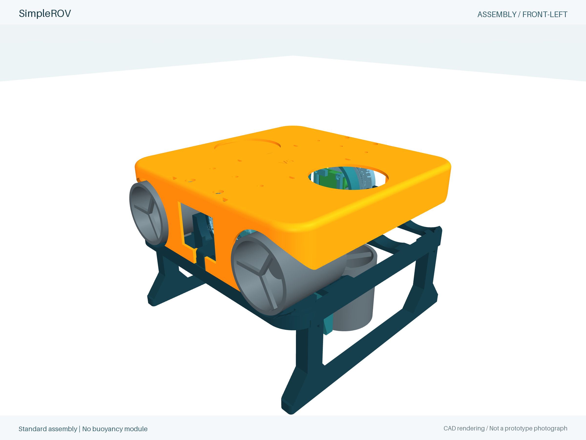
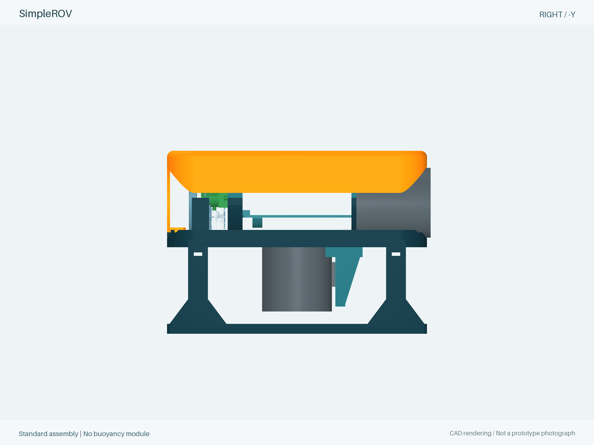
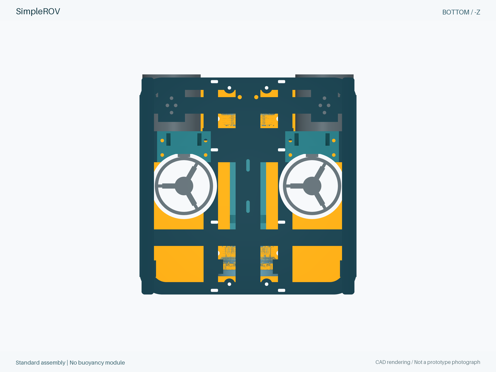
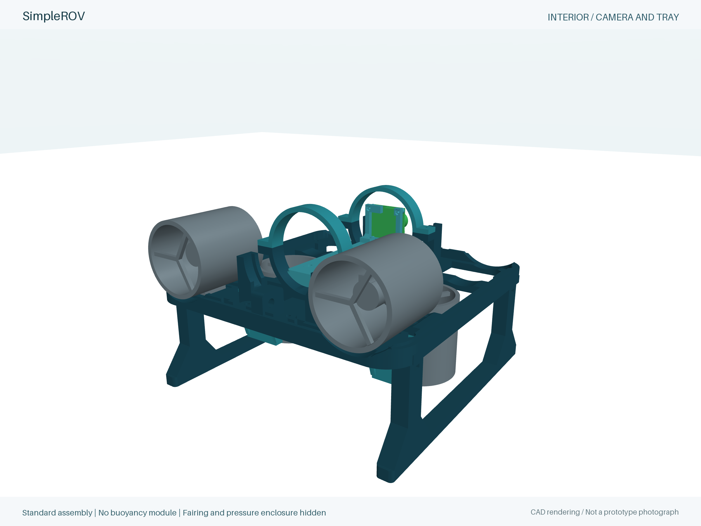
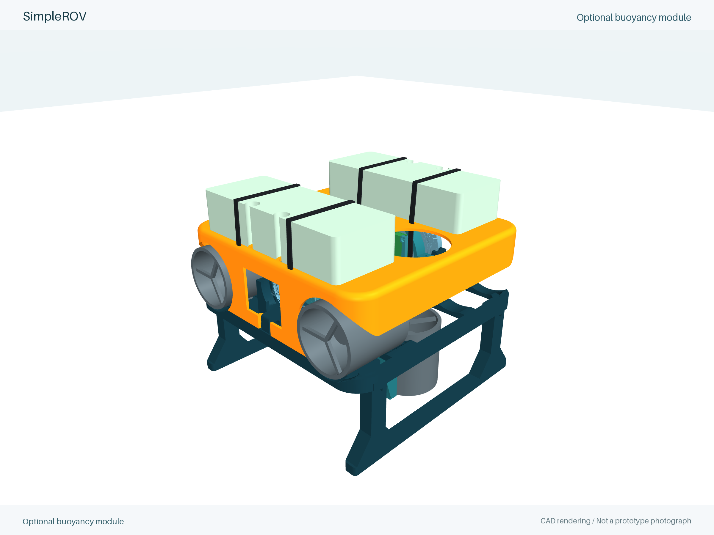
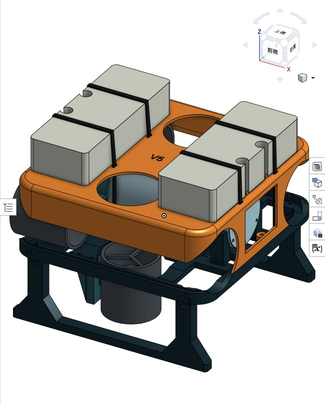
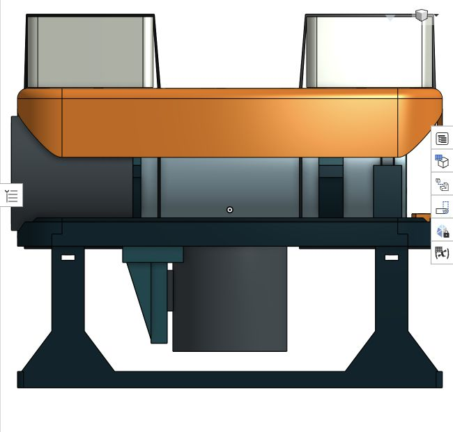

# Structure gallery

Nine 2400 × 1800 CAD views show the current geometry. Standard views omit top foam and straps. The six orthographic views share one field of view: X forward, Y left, Z up.

These are renderings, not prototype photographs. Thrusters are reconstructed dimensional references; the camera and enclosure use attributed supplier CAD. Enclosure parts use an opaque display finish for legibility; display colors are not procurement specifications. Unselected electronics and wiring are not illustrated.

## Standard assembly

## Orthographic views

| Front | Rear |
|:---:|:---:|
|  |  |

| Left | Right |
|:---:|:---:|
|  |  |

| Top | Bottom |
|:---:|:---:|
|  |  |

## Interior

The fairing and all pressure-enclosure components are hidden to expose the existing camera, tray, frame and thrusters. Final electrical layout and positive tray retention remain pending.

## Optional buoyancy

Foam is selected from measured mass and trim. It is not part of the default assembly. See [buoyancy and trim](buoyancy.md).

## Onshape screenshots

The following are actual captures of the historical public Onshape assembly viewport. They show the **optional buoyancy foam and straps fitted**; current default foam-free assemblies are defined by the repository STEP files. The screenshots retain the original geometry and view state, cropped to the CAD viewport; they are not synthetic illustrations.

[Open Onshape](https://cad.onshape.com/documents/256f9be06adfdc472f7aac06/w/aefb43ce726d3d5c24877f23/e/1186baa4f5bb2c01f6be971a). Ten printed parts are imported editable solids without native sketch history. The commercial rear cap imported as an open reference shell; local OEM STEP remains the supplier reference. See [round-trip checks](../validation/onshape/ONSHAPE_ROUNDTRIP.json).

## Provenance

[Rendering source](../tools/docs/render_gallery.py) · [CAD view metadata and hashes](../validation/gallery.json) · [Onshape capture record](../validation/onshape/screenshots.json).
