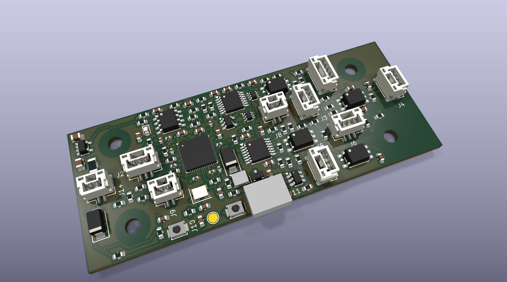

# Hardware and connections

SimpleROV v0.0.1 uses a four-channel controller/interface PCB, purchased bidirectional ESCs and a separate power harness. The initial commissioning configuration is a regulated **12 V source with a 5 A total current limit**, followed by controlled individual-motor checks. A mobile battery and the complete electrical package remain subject to the documented procurement and fit holds.

[Hardware directory](../electronics/README.md) · [Architecture](../electronics/architecture.md) · [Wiring](../electronics/wiring.md) · [Power](../electronics/power.md) · [Commissioning](../electronics/commissioning.md)

## Editable board and manufacturing review



The **80 × 32 × 1.6 mm, four-layer** RP2040 controller includes an ICM-42688-P IMU, external watchdog, latched arming logic, four separate ESC receiver channels, Bar02/leak inputs and USB service. It is an unpowered engineering prototype.

[KiCad project](../electronics/pcb/controller/SimpleROV001_control.kicad_pro) · [Schematic PDF](../electronics/pcb/drawings/schematic.pdf) · [Top assembly](../electronics/pcb/drawings/assembly_top.pdf) · [Bottom assembly](../electronics/pcb/drawings/assembly_bottom.pdf) · [Board BOM](../electronics/pcb/controller/BOM.csv) · [Manufacturing and reproduction](../electronics/pcb/README.md) · [Pin map](../electronics/interfaces/CONTROLLER_PINOUT.csv)

## Material lists

| List | Purpose |
|---|---|
| [System BOM](../electronics/bom/SYSTEM_BOM.csv) | Purchased modules, PCBA, sensors, power parts, shore equipment and conditional items |
| [Harness BOM](../electronics/bom/HARNESS_BOM.csv) | Power, ESC control, phases, UART, USB, Ethernet and sensor cable assemblies |
| [Consumables and tools](../electronics/bom/CONSUMABLES_TOOLS.csv) | Added mounting hardware, insulation, strain relief, identification, spares and test tools |
| [Controller mating parts](../electronics/bom/CONTROLLER_HARNESS_PARTS.csv) | GH housings/contacts, source-side sense resistor and remote leak-probe EOL resistor |
| [Mechanical BOM](../bom/README.md) | Existing prints, 134 base metal parts and commercial mechanical references |

A system row for an assembled controller is one PCBA, not a second order for its populated chips. Thrusters, camera and enclosure references already counted in the mechanical BOM are cross-references with zero incremental purchase quantity. A hold status does not mean that a part is unnecessary. [Quantity and procurement rules](../electronics/procurement.md).

## How it connects

```text
Computer / gamepad <--> Ethernet tether <--> Pi Zero 2 W + USB/Ethernet hub
                                              |-- USB --> Camera
                                              `-- 3.3 V UART --> RP2040 controller
                                                                  |-- Sensors
                                                                  `-- 4 ESCs --> 4 thrusters
```

The Pi handles compressed video and network commands. The real-time MCU will implement command validity, arming, classical stabilization and motor signals. Each ESC controls a three-phase brushless motor. Propulsion current goes through the protected harness, not the controller PCB. No flashable vehicle firmware is included yet.

The selected output architecture uses each ESC's BEC only for that channel's optocoupler receiver side. The four BEC positives and the regulated logic supply must not be paralleled. Follow the delivered board connector table, including its enable and fault behavior. Missing pulses or a fixed level does not constitute a valid neutral pulse. [Exact connection procedure](../electronics/wiring.md).

## Fit and verification

The controller mounting contract is **80 × 32 × 1.6 mm**, with four M3 clearance holes aligned to the existing tray slots. The declared board-envelope check uses 5 mm insulating spacers; its PCB bottom is at global Z = 13 mm. Four screws, eight washers and four nuts add **16 metal pieces** to the base 134; these are listed separately with four insulating spacers.

[Mechanical contract](../electronics/interfaces/MECHANICAL_CONTRACT.json) · [Declared-envelope report](../electronics/validation/controller_mount.json) · [Mount review STEP](../electronics/mechanical/controller-mount-review.step).

The [native STEP fit report](../electronics/validation/native_controller_fit.json) additionally checks all 118 exported PCB/component solids, nine GH mating-plug reservations and nine wire-bend reservations against the unchanged tray, camera carrier, tube, end fittings, camera and added mounting hardware. The [native fit STEP](../electronics/mechanical/native-controller-fit.step) makes that nominal placement reviewable. No overlap above 0.01 mm³ was found in that scope. Two component models are declared dimension envelopes; cable bends are engineering reservations. This does not establish that the battery, four ESCs, host/hub, USB plugs, power junctions and complete harness fit the current 50 mm-series / 150 mm enclosure. Tray axial retention, connector access, temperature, penetrators, real fit and sealing still need verification. The standard mechanical assembly and its dimensions have not been enlarged to imply a solution.

The exact X2 battery-voltage interpretation, mobile battery pack, cable seals and full packaging are explicit release gates. The current X2 reference is for freshwater. Start with the [commissioning checklist](../electronics/commissioning.md); complete the physical gates before powered water operation.

[Fabrication and JLC review files](../electronics/manufacturing.md).
