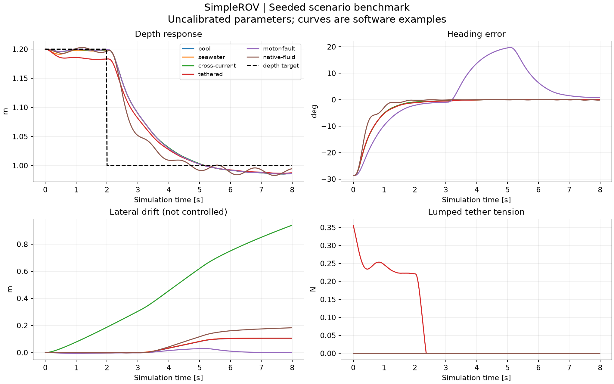

# Simulation foundation

SimpleROV runs on **MuJoCo 4.0.1**, verified against the official latest stable release on **2026-11-14**. [Official release](https://github.com/google-deepmind/mujoco/releases/tag/4.0.1) · [Runtime record](../validation/engine.json).

This foundation supports repeatable controller development, fault experiments, calibration and a sensor-based learning task. It remains an uncalibrated rigid-body approximation. A software benchmark is not an experimental validation or a global optimality result.

## Architecture and timing

```text
Scenario + assembly + validated overrides + seed
                       |
          resolved per-instance configuration
                       |
50 Hz control / action -> bounded allocation / normalized thrust curve
                       |
       delay -> deadband -> lag -> slew limit -> effectiveness
                       |
500 Hz MuJoCo rigid-body plant + buoyancy + water-relative loads + tether
                       |
             sample-and-hold sensor proxies
                       |
     classical controller or Gymnasium policy observation
                       |
       CSV traces + complete run metadata + regression metrics
```

Default physics timestep is 2 ms, control period 20 ms and sensor period 20 ms. Control and sensor periods must align with physics ticks. State-derived transforms are refreshed after each step, so rendering, returned truth and measurements describe the updated simulation time. Repeated sensor reads do not consume random draws or change the sample schedule.

| Module | Responsibility |
|---|---|
| [configuration.py](../simulation/mujoco/configuration.py) | Strict override keys, parameter validation and seeded uncertainty draws |
| [environment.py](../simulation/mujoco/environment.py) | MuJoCo plant, runtime physical parameters, truth API, controller and metadata |
| [hydrodynamics.py](../simulation/mujoco/hydrodynamics.py) | Water-relative passive drag and tension-only tether |
| [actuators.py](../simulation/mujoco/actuators.py) | Bounded allocation, command curve, delay, rate limits, lag and watchdog |
| [sensors.py](../simulation/mujoco/sensors.py) | Timestamped pressure, attitude, gyro and specific-acceleration proxies |
| [gym_env.py](../simulation/mujoco/gym_env.py) | Seedable, bounded sensor-observation depth/heading task |
| [calibrate.py](../simulation/mujoco/calibrate.py) | Nonnegative steady-tow drag fit from measured CSV |
| [benchmark.py](../simulation/mujoco/benchmark.py) | Seeded scenario metrics, traces and optional plots |

## Run a scenario

```bash
python simulation/mujoco/run.py --viewer --manual --scenario cross-current --seed 7
python simulation/mujoco/run.py --render --scenario tethered --output-dir runs/tethered
python simulation/mujoco/run.py --scenario seawater --feedback sensors --seconds 16
```

The normal runner now uses sampled sensor feedback by default. `--feedback truth` selects the ideal-state diagnostic baseline. Keyboard controls remain W/S, A/D, U/J and X. The GUI still displays ground truth for inspection; controller feedback selection is separate.

| Scenario | Changes from baseline | Interpretation |
|---|---|---|
| `pool` | 997 kg/m³ water, no current/tether | Fully submerged freshwater example |
| `seawater` | Density 1025 kg/m³ | Example density only; no waves, salinity chemistry or realistic ocean environment |
| `cross-current` | 0.12/0.10 m/s X/Y current with slow oscillation | Water-relative drag and lateral drift; no independent sway actuator |
| `tethered` | Tension-only spring/damper from a fixed anchor to the chassis eye | Lumped cable force, not a distributed cable model |
| `motor-fault` | H_LEFT effectiveness zero | Controlled allocation rank drops to three; conflicting targets cannot all be achieved |
| `native-fluid` | MuJoCo ellipsoid fluid backend | An assumed envelope approximation for comparison, not an identified vehicle model |

Both foam-free `base` and optional `with-buoyancy` assemblies are supported. Switching assembly does not infer mass, CG/CB, displacement or hydrodynamic coefficients. Runtime mass, inertia, CG and reaction torque overrides update the physical plant and allocation, not only metadata.

## Hydrodynamic scope

### Calibratable analytic backend

For a drag point fixed in the body, compute its velocity including angular motion, subtract world current and rotate into body axes. Apply

`F = -D_linear * v_relative - D_quadratic * abs(v_relative) * v_relative`

with the analogous angular damping law. Nonnegative diagonal coefficients guarantee nonpositive drag power relative to water. Apply the force at the configured drag center, preserving the resulting moment. Current can contain a uniform component, a sinusoidal component and a depth-dependent shear. These coefficients already include their dimensional force scaling; do not multiply them by density again. The shear option changes translational flow locally; fluid-vorticity effects on rotational damping are not modeled. The native backend sees the current evaluated at the vehicle as locally uniform wind.

Buoyancy is `rho * g * displaced_volume`, applied at configured CB. Gravity comes from MuJoCo and the configured rigid-body mass. All quantities are SI; body axes are X forward, Y left, Z up. Relative-motion convention follows the [marine craft model reference](https://www.fossen.biz/html/marineCraftModel.html), but this analytic implementation omits added-mass acceleration and Coriolis terms. It is not a full implementation of that model.

### Native ellipsoid comparison

The alternative enables one hidden, noncolliding ellipsoid with MuJoCo `fluidshape="ellipsoid"`, nonzero density/viscosity and configured wind/current. Explicit Python drag is disabled in this mode to prevent double-counting. The default native coefficients disable Kutta and Magnus lift. MuJoCo supplies its documented ellipsoid fluid approximation; see [official fluid documentation](https://mujoco.readthedocs.io/en/latest/computation/fluid.html).

The assumed 0.1065 / 0.105 / 0.074 m semiaxes do not identify the real freely flooded frame. Native fluid effects do not make the simulation CFD, establish physical added-mass coefficients or guarantee better accuracy than calibrated analytic drag. Compare and calibrate rather than selecting a backend solely for visual complexity.

### Tether approximation

Let `extension = length - rest_length`. A slack line exerts zero force. A taut line applies the nonnegative spring/damping tension toward the anchor at the real chassis attachment, including its moment. It cannot push. There is no distributed cable mass, buoyancy, hydrodynamic drag, slack-loop shape, cable contact or winch model. Tether coefficients and geometry are illustrative.

## Actuators and allocation

The four actuators remain H_LEFT, H_RIGHT, V_LEFT, V_RIGHT. `ROV.step()` accepts nominal force targets in N; actual forces include configured effectiveness, transport delay, lag, deadband and slew limits. `step(None)` holds the last received target until its timeout, then commands zero through the actuator dynamics; it does not instantaneously stop vehicle motion. No electrical ESC, battery or propeller-spin model is implied.

`step_normalized()` maps four commands in [-1, 1] through a monotone, assumed bidirectional force curve. It is a simulation interface, not a PWM calibration. Replace the curve and limits with measured values.

Allocation minimizes the weighted wrench residual under per-motor bounds. It evaluates feasible faces of the four-dimensional box when the unconstrained solution is infeasible. Force rows have weights 1 and roll/yaw moment rows weights 10; these are engineering priorities with dimensional scaling, not universal optimal weights. Saturation and rank loss are returned explicitly. `allocator.last` records requested/achievable wrench, residual, rank and saturation. Predicted allocation assumes steady motor response; `diagnostics` records actual current thrust wrench.

The classical controller uses configurable depth PI/velocity damping, roll/yaw feedback, buoyancy feedforward and conditional integral accumulation under saturation. By default it uses the scenario's configured mass and volume for feedforward; benchmark results do not demonstrate robustness to unknown physical parameters. Its ideal-state API remains available for regression tests.

## Sensors and truth

`state()` is ground truth. `measurements()` contains timestamped sample-and-hold proxies:

| Measurement | Default illustrative uncertainty |
|---|---|
| Pressure | 15 Pa white noise, 10 Pa reset-fixed bias standard deviation |
| Depth | Derived from pressure, configured water density and atmospheric pressure |
| Depth rate | Filtered finite difference of measured depth; 0.15 s filter time constant |
| Attitude | Quaternion with 0.002 rad small-angle noise |
| Gyro | 0.002 rad/s noise standard deviation |
| Specific acceleration | MuJoCo IMU-site acceleration with 0.02 m/s² noise standard deviation |

Attitude is a noisy orientation proxy, not a validated IMU/magnetometer filter. There is no perfect global position or linear-velocity measurement in the policy observation. Temperature drift, bias random walks, magnetics, DVL, sonar, video estimation, pressure-port dynamics and packet dropouts are not modeled. The sensor assumptions require real sensor selection and identification.

## Gymnasium foundation

Install the optional, pinned Gymnasium 1.4.0 interface:

```bash
python -m pip install -r requirements/rl.txt
python simulation/mujoco/verify_gym.py
```

```python
import numpy as np
from simulation.mujoco.gym_env import SimpleROVEnv

env = SimpleROVEnv(scenario="cross-current", randomize=True)
observation, info = env.reset(seed=7)
for _ in range(200):
    # Zero action is only an API example, not a useful trained policy.
    observation, reward, terminated, truncated, info = env.step(
        np.zeros(4, dtype=np.float32)
    )
    if terminated or truncated:
        break
env.close()
```

Actions are four normalized thruster commands at 50 Hz. The 13 observation entries are depth error; sine/cosine of heading error; roll/pitch; depth rate; three gyro axes; four previous actions. Representation scales are [2 m, 1, 1, pi rad, pi rad, 2 m/s, 4 rad/s, 4 rad/s, 4 rad/s, 1, 1, 1, 1], clipped to [-1, 1]. These are representation scales, not physical sensor bounds.

The reward penalizes measured depth/heading/attitude error, effort and action changes, scaled by the control period. Surface-envelope violation, excessive attitude and collision terminate the task; episode duration truncates it. A ground-truth diagnostic is returned in `info` for evaluation only. Use the observation for policy input.

Reset randomization can vary mass, volume, drag, lag and actuator effectiveness with a recorded seed. It is an assumed uncertainty distribution, not a measured population. Gymnasium's environment checker, deterministic reset and time-limit semantics are tested. No training algorithm or trained policy is included; classical control remains the initial real-vehicle baseline.

## Calibration and provenance

`--config` accepts a strict JSON override object or a calibration report containing `overrides`. A small change can be applied without rebuilding CAD:

```json
{"water": {"current_world_m_s": [0.05, 0.0, 0.0]}}
```

```bash
python simulation/mujoco/run.py --config my-overrides.json --seed 7
python simulation/mujoco/calibrate.py measured-tow.csv --output runs/calibrated-drag.json
python simulation/mujoco/run.py --config runs/calibrated-drag.json --render
```

Tow CSV columns: `velocity_x_m_s,velocity_y_m_s,velocity_z_m_s,drag_x_N,drag_y_N,drag_z_N`. Drag columns are the signed force of water on the vehicle, opposite velocity, with other loads removed. Supply at least six finite, nonzero samples at distinct speed magnitudes per axis. The tool fits nonnegative diagonal linear/quadratic coefficients and reports residuals and input SHA256. It does not verify the measurement setup or identify rotational/coupled drag, thrust, inertia or added mass.

Each run writes `run_metadata.json` containing exact engine/library version, seed, assembly, scenario, resolved randomized parameters, source hashes and feedback mode. Traces include actual and measured depth, targets, actual thruster force, current, tether tension and allocation residual. Source files are not changed by overrides. A ROV plant has an immutable constructor seed; construct a new plant to change physical/sensor draws. The Gymnasium reset API creates a new seeded plant per episode.

## Regression and benchmark

```bash
python simulation/mujoco/verify.py
python simulation/mujoco/verify_foundation.py
python simulation/mujoco/verify_manual.py
python simulation/mujoco/verify_gym.py
python simulation/mujoco/benchmark.py --seconds 8 --seeds 0 1 2
```

[Benchmark record](../validation/simulation_benchmark.json) · [Foundation checks](../simulation/mujoco/FOUNDATION_CHECKS.json) · [Gym checks](../simulation/mujoco/GYM_CHECKS.json)



The published 18-case benchmark uses six scenarios and three sensor seeds. Metrics include last-two-second depth/heading/roll RMS, lateral drift, integrated squared thrust (N²s, not electrical energy), maximum tether tension and allocation residual. The plot shows the first seed; all seeds are in the record. Failure is evaluated as rank loss and visible residual, not successful four-axis control. Regression envelopes are software checks, not vehicle requirements.

Tests also cover drag passivity, bounded-allocation KKT conditions, zero-compression tether, transport delay, stale-command timeout, sample holding, deterministic replay, runtime mass/CG/reaction changes, synthetic drag-fit recovery and 1/2/4 ms timestep comparison. A synthetic fit proves numerical behavior only. Platform/version changes can alter numerical results; exact local replay does not guarantee cross-platform bitwise identity.

There is no free-surface, waves, CFD, thruster-wash interaction, complete cable dynamics, electrical power model or real underwater optics. These should be added only with a concrete use case, data and validation, rather than being represented as solved by increasing simulator complexity.
