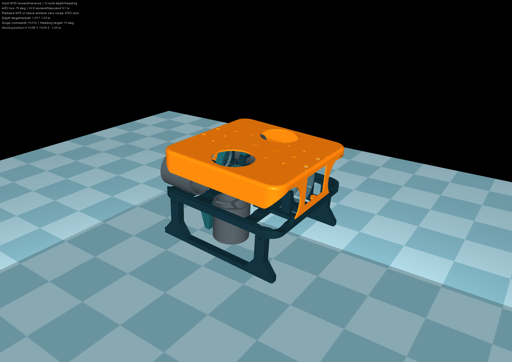

# MuJoCo simulation and keyboard driving

**Engine: MuJoCo 4.0.1.** For the complete timing, sensor, current/tether, actuator and calibration details, start with the [simulation foundation](simulation-foundation.md).

A four-thruster rigid-body demonstrator tied to the CAD coordinates. CAD meshes supply appearance; separate proxies supply simplified collision. Neither is a CFD model.

## Installation and launch

From the repository root, use Python 3.12:

```bash
python3 -m venv .venv
source .venv/bin/activate
python -m pip install -r requirements/sim.txt
python simulation/mujoco/verify.py
python simulation/mujoco/run.py --viewer --manual --seconds 300
```

Windows activation: `.venv\Scripts\activate`. On macOS, open `launch-macos.command` after installing dependencies, or run `python simulation/mujoco/launch_macos.py --manual --seconds 300`. Manual driving uses a dedicated GLFW window on the ordinary Python main thread and bypasses the native viewer's letter-key shortcuts.

Without `--manual`, `run.py` executes an automatic depth, surge and heading sequence. For the automatic native viewer on macOS, use `python simulation/mujoco/launch_macos.py --seconds 120`, or `mjpython simulation/mujoco/run.py --viewer --seconds 120`. The launcher repairs a missing virtual-environment libpython link when required; system Python is unchanged.

If `Library not loaded: @executable_path/../lib/libpython3.12.dylib` occurs, use the launcher. This is a known mjpython/uv virtual-environment path issue, not failed CAD loading. [Official issue](https://github.com/google-deepmind/mujoco/issues/1923).

## Configurations

Default `--configuration base` loads `simple_rov.xml`, without top foam/straps, envelope 213 × 210 × 148 mm. The optional model is `simple_rov_with_buoyancy.xml`, height 184.7 mm:

```bash
python simulation/mujoco/run.py --viewer --manual --configuration with-buoyancy --seconds 120
```

The Python equivalents are `ROV(configuration="base")` and `ROV(configuration="with-buoyancy")`. The selection changes appearance and associated collision proxies. **It does not derive mass, inertia, CG, CB, displacement or drag from the assembly.** Both share explicit assumptions pending physical calibration; see [buoyancy](buoyancy.md).

## Driving

Click the window to give it keyboard focus.

| Input | Behavior |
|---|---|
| Hold W / S | +2 / -2 N total surge force; release returns the command to zero |
| A / D | Adjust heading target left / right by 15° per press |
| U / J | Adjust target depth up / down by 0.1 m per press |
| X | Cancel surge and hold the current depth and heading |
| Left mouse drag / wheel | Orbit / zoom |
| Esc | Close the window |

Loss of focus cancels surge; coasting may continue. Heading/depth targets persist after releasing A/D/U/J. X does not hold horizontal position or instantly brake. Sway and pitch are not independent commands. Depth targets are limited to 0.35-2.5 m to stay submerged and away from the modeled floor. The camera follows the vehicle; watch tiles and X/Y coordinates to see motion.

No gamepad integration or onboard firmware is included.

## Outputs

```bash
python simulation/mujoco/run.py --render --output-dir runs/demo
```

Automatic recording writes `demo.mp4`, `demo_states.csv`, `simulation.png` and `front-camera.png`. Manual runs write `manual_states.csv`; automatic viewer runs write `viewer_states.csv`. Every run also writes `run_metadata.json` with the resolved parameters, feedback mode, seed and source hashes. Omit `--output-dir` for a UTC timestamp directory under `runs/`.

[Watch the scenario videos](videos.md) · [Compact automatic demonstration](../simulation/mujoco/demo.mp4)



## Python control interface

```python
from simulation.mujoco.environment import ROV

rov = ROV(configuration="base")
# Body-axis commands: surge N, heave N, roll Nm, yaw Nm
forces = rov.allocate(surge_N=2, heave_N=0, roll_Nm=0, yaw_Nm=0)
rov.step(forces)
# Classical controller: target depth m, surge N, heading rad
forces = rov.controller(depth=1.2, surge_N=2, yaw=0.5)
position, rpy, velocity, angular_velocity = rov.step(forces)
```

`step` accepts nominal actuator force targets in newtons, ordered H_LEFT, H_RIGHT, V_LEFT, V_RIGHT, not PWM or RPM. X is forward, Y left, Z up; depth is -z. Positive vertical force is upward. Actual propeller handedness and ESC commands must be mapped to these signs by submerged calibration.

[ACTUATOR_MAP.json](../simulation/mujoco/ACTUATOR_MAP.json) records the 6 × 4 wrench matrix and reference points. Controlled rows are Fx/Fz/Mx/Mz, rank four. Pitch and sway remain passive/coupled axes. The ideal `front_camera` represents the upright image after rotating the physically inverted camera image 180°; there is no refraction, turbidity, scattering, lens distortion or estimation model.

## Water model and assumptions

**Run through `run.py` or the ROV class.** Buoyancy, drag and motor lag live in `environment.py`; a generic XML viewer omits these Python forces.

`config.json` exposes the `assumed_` parameters: 1.4 kg mass, CG Z = 5 mm, CB Z = 35 mm, inertia, displacement, linear/quadratic translational and angular drag, 0.12 s motor lag and reaction torque. The assumed volume gives 1% positive buoyancy at 997 kg/m³; this is not a CAD/material measurement.

The 20.59 N forward limit uses the supplier's maximum-thrust reference; reverse 10 N is an assumed placeholder. Measure continuous forward/reverse thrust curves, deadband, saturation and response before claiming physical performance.

The environment assumes fully submerged still water, away from the surface. Configurable currents, a tension-only lumped tether and actuator outages are available. The default analytic model omits added mass; an optional native ellipsoid fluid model is available for comparison. Native fluid drag and explicit analytic drag are mutually exclusive. The full CAD envelope must stay below the configured surface-clearance boundary. There is no free surface, water entry/exit, waves, thruster interaction, distributed cable or CFD. Changing density alone does not simulate an ocean.

## Classical remote-control loop

```text
Keyboard / future tether commands
        ↓ surge force, target depth, target heading
Depth PI + vertical-velocity damping, roll and heading feedback
        ↓ requested force and moments
Bounded four-thruster allocation → actuator response → vehicle
        ↑ sampled pressure / attitude / gyro feedback
```

The controller runs at 50 Hz with net-buoyancy feedforward and conditional integral accumulation. Surge is a force command, not closed-loop speed control. The normal runner uses sampled sensor proxies; `--feedback truth` selects the ideal diagnostic baseline. No parameters are fitted while driving. Sensor-noise seeds only make runs repeatable.

For the physical robot, first establish mechanical fit, sealing and trim, then calibrate thrust signs, neutral, sensor orientation and pressure. Add the tether protocol and onboard implementation after selecting hardware. Check command timeout and individual motor directions before enabling depth and heading hold. [Prototype build plan](build-plan.md).

## Rebuild and verification

```bash
python simulation/mujoco/build_model.py
python simulation/mujoco/verify.py
python simulation/mujoco/verify_manual.py
python simulation/mujoco/verify_foundation.py
python simulation/mujoco/verify_driving_window.py
```

The last command requires a local desktop/OpenGL window. Checks cover actual XML force/torque against the CAD map, rank, movement signs, depth hold/steps, roll recovery, assembly visibility and finite state. Manual checks cover six directional target changes, release/focus behavior and target limits. The window test calls callbacks and checks its framebuffer; it does not inject OS keyboard events.

Reports record source hashes. Passing means the software is consistent under the stated assumptions; it does not establish sealing, strength, depth or real control performance. Recalibrate with physical measurements and repeat the same checks.

[MuJoCo XML reference](https://mujoco.readthedocs.io/en/stable/XMLreference.html) · [ArduSub frame reference](https://ardupilot.org/sub/docs/sub-frames.html) · [Physical prototype plan](build-plan.md).
