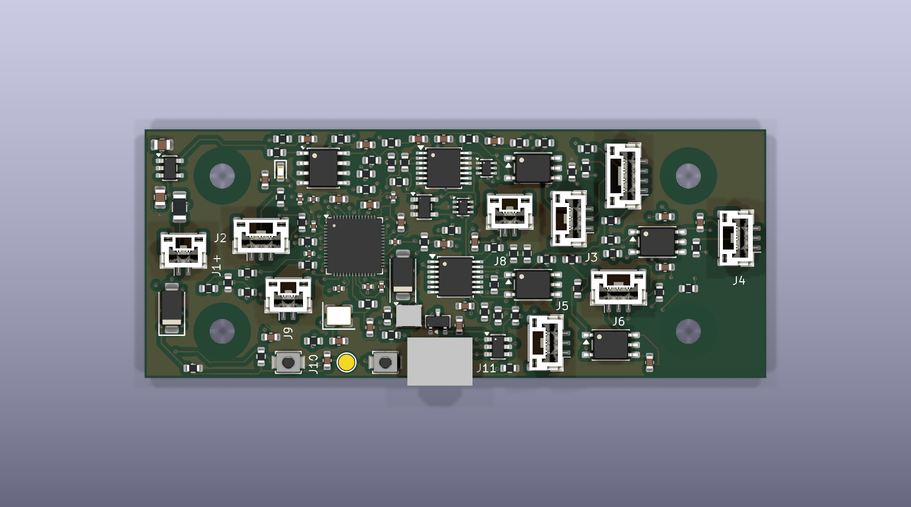
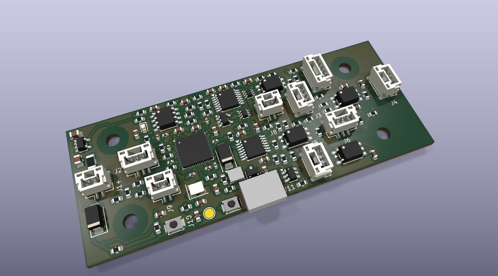

# Electronics — SimpleROV v0.0.1

This directory contains the controller PCB engineering work, system selection, material lists, wiring and commissioning requirements for the current small four-thruster mechanical baseline. The controller/interface PCB carries low-power control and sensing; purchased bidirectional ESCs and a separate fused harness carry motor current.

**Engineering prototype; no powered, thermal, sealing or water validation has been performed.** The mobile battery and complete vehicle electrical package are not frozen. This is not an instruction to buy every row or submit an unreviewed assembly order.

| Start here | Contents |
|---|---|
| [Editable KiCad project](pcb/controller/SimpleROV001_control.kicad_pro) | Four-layer 80 × 32 mm controller, self-contained libraries and models |
| [Schematic PDF](pcb/drawings/schematic.pdf) | Full circuit and connector references |
| [PCBA BOM](pcb/controller/BOM.csv) | Exact manufacturer part numbers and populated quantities |
| [Manufacturing package](pcb/README.md) | Gerber, separate drills, placement, assembly drawings and reproduction |
| [Controller mating parts](bom/CONTROLLER_HARNESS_PARTS.csv) | Cable housings, contacts and external sense/probe resistors |
| [Architecture](architecture.md) | Operator, video host, real-time controller, propulsion and fault-handling responsibilities |
| [Wiring](wiring.md) | Power tree, ESC channel assignment, UART, camera, pressure sensor and port reservations |
| [Power](power.md) | First-stage 12 V/5 A test configuration, battery-voltage boundary and current/thermal budgets |
| [Battery RFQ](battery-rfq.md) | Concrete finished-pack requirements and release gates |
| [Procurement](procurement.md) | Quantity conventions, selected references, alternatives and purchase holds |
| [System BOM](bom/SYSTEM_BOM.csv) | Modules and purchased assemblies |
| [Harness BOM](bom/HARNESS_BOM.csv) | Cable assemblies and terminations |
| [Consumables and tools](bom/CONSUMABLES_TOOLS.csv) | Mounting, insulation, identification, spares and test equipment |
| [Mechanical interface](interfaces/README.md) | Current enclosure, tray, board contract and remaining fit requirements |
| [Commissioning](commissioning.md) | Unpowered, powered and recoverable shallow-water checks |
| [Sources](sources.json) | Manufacturer references and research scope |

The hardware work follows the current repository's geometry. Historical large-vehicle PCBs are not part of this design. Ordinary electronics stay dry; the purchased thrusters are wet. A generic PCB mounting envelope is not evidence that a full battery/ESC/video stack fits the enclosure.

[Project hardware overview](../docs/hardware.md) · [Mechanical BOM](../bom/README.md) · [Future onboard firmware](../firmware/README.md).

## Native PCB views

| Top | Perspective |
|:---:|:---:|
|  |  |

These renders come from the delivered native PCB. They are design views, not photographs of a built or tested board. [Independent electrical review](validation/ELECTRICAL_REVIEW.md) · [Recorded integration checks](validation/INTEGRATION_CHECKS.json).

[Fabrication and JLC review files](manufacturing.md).
